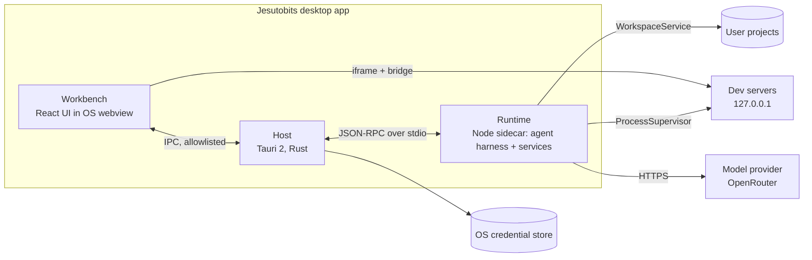

**A visual, extensible AI agent workspace for building real software.**

Jesutobits is a desktop app where an AI agent plans, edits, runs, tests and verifies real projects while you watch. You see the running app inside the workspace, point at an element and change it (with the change written into your source code), and shape the whole environment with themes, companion skins and, later, mods.

It combines a capable coding-agent harness, an IDE-like workbench, live previews with source-connected visual editing, and a permissioned customisation ecosystem. That combination is the product's identity.

> **Status:** **Phase 0** in progress (see [ROADMAP](docs/ROADMAP.md#5-next-implementation-milestone)). The monorepo, CI, `packages/protocol` and a stub runtime that completes the stdio handshake exist. No user-facing features yet.

## How to read these docs

| If you want to… | Read |
|---|---|
| Understand the product and its users | [Product vision](docs/PRODUCT_VISION.md) |
| See what must be built, with IDs | [Requirements](docs/REQUIREMENTS.md) |
| See how it looks and behaves | [UX and interface](docs/UX_AND_INTERFACE.md) |
| Understand the system and its boundaries | [Architecture](docs/ARCHITECTURE.md) |
| Build the agent loop, providers, tools, context, verification | [Agent harness](docs/AGENT_HARNESS.md) |
| Build previews and visual editing | [Visual editing](docs/VISUAL_EDITING.md) |
| Build the companion | [Companion system](docs/COMPANION_SYSTEM.md) |
| Build themes, skins and mods support | [Extension system](docs/EXTENSION_SYSTEM.md) |
| Understand permissions and threats | [Security](docs/SECURITY.md) |
| Know where data lives | [Data and persistence](docs/DATA_AND_PERSISTENCE.md) |
| Write and run tests | [Testing strategy](docs/TESTING_STRATEGY.md) |
| Plan the work | [Roadmap](docs/ROADMAP.md) |
| Find where code goes | [Project structure](docs/PROJECT_STRUCTURE.md) |
| Set up a machine | [Development setup](docs/DEVELOPMENT_SETUP.md) |
| See why decisions were made | [Decision records](docs/DECISIONS/README.md) |
| Check a technical fact and its source | [Research notes](docs/RESEARCH_NOTES.md) |
| Work on this repo as an AI agent | [AGENTS.md](AGENTS.md) |

## Decision status legend

Every document distinguishes:

- **Confirmed / Accepted**: agreed; build on it.
- **Provisional**: agreed default tied to a named spike or revisit trigger (for example ADR-0009 depends on Spike S2).
- **Proposed / Later**: designed so current work does not block it; not in the MVP.
- **Open question**: listed in [ROADMAP section 4](docs/ROADMAP.md#4-unresolved-questions) with a recommended default.
- **Verified fact**: has an `RN-xx` entry with a source in [Research notes](docs/RESEARCH_NOTES.md). Anything without one is a recommendation.

## Architecture at a glance

Key decisions (details in `docs/DECISIONS/`):

| Topic | Decision |
|---|---|
| Shell | Tauri 2, with the UI and runtime kept shell-agnostic (ADR-0001) |
| Agent runtime | Official Node.js binary shipped as a Tauri sidecar, no native addons (ADR-0002) |
| IPC | JSON-RPC 2.0 over stdio, relayed and allowlisted by the Host (ADR-0003) |
| Editor | Monaco behind a thin wrapper (ADR-0004) |
| Models | Own provider contract; OpenRouter adapter over plain HTTP + SSE (ADR-0005) |
| Companion | Jesutobits-owned state machine; static and dotLottie renderers first (ADR-0006) |
| Extensions | Stage 1 declarative only; sandboxed UI and MCP integrations later (ADR-0007) |
| Storage | Settings JSON, SQLite via `node:sqlite`, OS keychain (ADR-0008) |
| Visual editing | Build-time JSX instrumentation through an injected Vite plugin (ADR-0009) |
| Preview isolation | Cross-origin iframe on 127.0.0.1, validated postMessage, headless browser for agent checks (ADR-0010) |

## MVP in one paragraph

Windows desktop app; OpenRouter models with tool calling; an agent that reads, edits, runs commands with approval, uses Git (read and commit), runs checks and labels its work Verified only with evidence; a workbench with explorer, Monaco, terminal, timeline, problems and a minimal Git panel; live previews for any project with a dev script; visual editing for React + Vite projects styled with Tailwind classes or inline styles; a truthful companion with three built-in skins; and locally installable themes and companion skins. See [ROADMAP section 2](docs/ROADMAP.md#2-mvp-versus-later) for what is explicitly later.

## Name

The product is called **Jesutobits**. The logo at the top of this file is [`docs/assets/jesutobits-logo.svg`](docs/assets/jesutobits-logo.svg), the box-drawing banner from AGENTS.md drawn as plain shapes by `scripts/gen-logo.mjs`, so it lines up in every Markdown preview and switches colours in dark mode. Edit the banner in the script and rerun it, never the SVG. A second mark, [`docs/assets/jesutobits-wordmark.svg`](docs/assets/jesutobits-wordmark.svg), has its text converted to outlines (from Space Grotesk, SIL Open Font Licence).

The name also appears in identifiers. These are the ones to keep stable once people use the app:

| Kind | Examples | Hard to change after 1.0? |
|---|---|---|
| Display text | "Jesutobits", window titles, docs | No |
| Package names and binaries | `@jesutobits/*`, `jesutobits-node`, `jesutobits-rg`, `jesutobits-ext` | No |
| Environment variables | `JESUTOBITS_*` | No |
| App identifier and data paths | `dev.jesutobits.app` (proposed) | **Yes** |
| Files in user projects and packages | `.jesutobits/`, `.jesutobitsignore`, `.jesutobitspkg`, `jesutobits-extension.json` | **Yes** |
| Protocols and DOM attributes | `jesutobits-ext://`, `data-jesutobits-loc`, `data-jesutobits-comp` | Partly (extensions may rely on them) |

The app identifier is reverse-DNS, so it should use a domain you control. Confirm it before Phase 7 (ROADMAP open question Q1), because it decides where user data is stored.

## Glossary

| Term | Meaning |
|---|---|
| **Host** | The Tauri (Rust) process: window, OS integration, credentials, PTYs, IPC relay |
| **Workbench** | The React UI inside the OS webview |
| **Runtime** | The Node sidecar process running the agent harness and services |
| **Services** | Preview and execution services (files, processes, previews, Git, visual source edits) inside the runtime process |
| **Session** | A conversation with the agent in one project, persisted |
| **Turn** | One user message and all the agent work it triggers |
| **Step** | One model response within a turn (plus the tool calls it requested) |
| **Risk class / Policy preset / Rule** | How the permission broker classifies and decides tool calls (SECURITY.md section 4) |
| **Checkpoint** | Pre-image of a file before an agent or visual edit, used for revert |
| **Evidence** | A recorded check result (typecheck, test, build, preview) used to label work Verified |
| **Adapter** | A preview strategy for a kind of project (`generic`, `vite-react`) |
| **Bridge** | The script injected into the preview to support inspection and drafts |
| **Draft / Apply** | Preview-only change vs persistent source change in visual editing |
| **Theme / Companion skin / Mod** | The three extension categories |
| **Stage 1 / 2 / 3** | Declarative, sandboxed UI, and integration extensions |
| **Restricted mode** | How untrusted projects open: no command execution |
| **Safe mode** | Jesutobits running with all extensions disabled |
| **General workspace** | A scratch folder for non-coding agent tasks |
