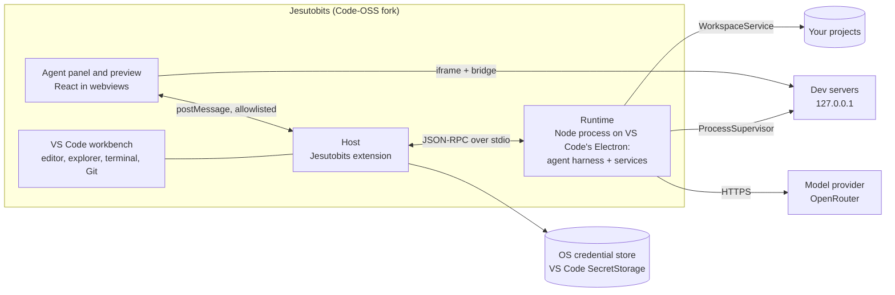

**An AI agent that builds in front of you.**

Jesutobits is a code editor with a co-builder in it. You describe what you want in plain words; the agent plans it, edits your files, runs your project and shows it to you, live, while you watch every step and approve the risky ones. You can point at something in the running app and change it, and the change lands in your source code.

It is built on VS Code (a Code-OSS fork), so the editor, terminal, Git and extensions are the ones you know. Jesutobits adds the agent, the live preview, visual editing, a companion, and a calmer "Studio" look for people who are new to code.

> **Status: early, pre-1.0 (0.2.0).** It works end to end on Windows, which is where it is tested by hand. Linux builds are tested under WSL; macOS builds are produced by CI but have not yet been opened on a real Mac.

## What you can do with it

- **Build with an agent.** It reads, searches, creates and edits files, runs commands and starts your app, shows its plan, and asks you when something is unclear. Every action appears in the timeline as it happens; nothing is shown as progress unless it really happened.
- **Stay in charge.** Choose how much it asks: Cautious (every edit and command), Balanced, or Autonomous (still asks before risky steps). Every change is checkpointed and can be reverted, and turns stop at limits you set for steps, tool calls, time and cost. Work is only labelled "Verified" with fresh evidence, such as a passing check.
- **See it running.** The preview panel shows your project as you build it:
  - React + Vite projects get **visual editing**: click an element to inspect it, change its Tailwind classes or inline styles, or ask the agent about it.
  - Anything with a `dev` or `start` script (Next.js, Vue, Svelte, an Express API...) runs its dev server.
  - Plain HTML/CSS/JS sites and canvas games are served with **live reload**.
  - Anything else (Python, Go, Rust...) runs the start command you or the agent give it, saved for the project. A program without a web page (a CLI, a game window) shows its live output.
- **Connect in one click.** **Sign in with OpenRouter**: no key to copy, and the key OpenRouter makes goes straight into your system's credential store. Use any OpenRouter model, or start with a **free coding model** (it is free because its maker may learn from your prompts; Jesutobits tells you so and asks first).
- **Make it yours.** Six Studio themes plus your own colours, a companion who reflects what the agent is really doing, your name and picture in the top bar, and a Learning Centre for the basics.

## Download

Builds come from the [jesutobits-ide](https://github.com/divinefavourak/jesutobits-ide) repository. Each package is its own download on a build's page under [Actions](https://github.com/divinefavourak/jesutobits-ide/actions) (you need to be signed in to GitHub):

| Platform | Download | Install |
|---|---|---|
| Windows 10/11 (x64) | `jesutobits-windows-x64-setup` | Run the installer; it installs for your user, no admin needed |
| Linux x64: Debian, Ubuntu | `jesutobits-linux-x64-deb` | `sudo apt install ./jesutobits-linux-x64-*.deb` |
| Linux x64: Fedora, openSUSE | `jesutobits-linux-x64-rpm` | `sudo dnf install ./jesutobits-linux-x64-*.rpm` |
| Linux x64: any distribution | `jesutobits-linux-x64-tar` | Unpack and run `Jesutobits-linux-x64/jesutobits` |
| macOS, Apple Silicon | `jesutobits-darwin-arm64-dmg` (or `-zip`) | Open the disk image and drag Jesutobits to Applications |
| macOS, Intel | `jesutobits-darwin-x64-dmg` (or `-zip`) | The same |

**On a Mac, the first open is blocked.** The app is not yet signed with an Apple Developer ID, so macOS says it cannot check it. Open **System Settings > Privacy & Security** and choose **Open Anyway** for Jesutobits (once). **On Linux,** saved keys use your desktop's keyring (GNOME Keyring or KWallet). Under WSL, use the Windows app instead.

## Privacy and safety

- **Your key stays secret.** It lives only in the OS credential store (through VS Code's SecretStorage), never in files, logs, the agent's context or the panel. Tests plant a fake key and fail if it shows up anywhere.
- **Nothing runs without permission.** Every agent action goes through a permission broker; the model's own text can never approve anything. Untrusted folders open in Restricted Mode, where no project code runs.
- **Previews are sandboxed.** The running app sits in an isolated frame on `127.0.0.1` and can never trigger edits or approvals. Secret files such as `.env` are never served.
- **Few network destinations.** Jesutobits itself talks only to your model provider (OpenRouter) and the Open VSX extension gallery. Telemetry and update checks are off. By default OpenRouter is asked to use only providers that do not keep your prompts.
- **Your profile is local.** Your name and picture stay on your computer.

## How it works



The work is split across two repositories:

- **This one (`jesutobits`):** the runtime (agent harness, tools, permissions, sessions, previews), the protocol, and the VS Code extension with its agent panel and preview webviews.
- **[`jesutobits-ide`](https://github.com/divinefavourak/jesutobits-ide):** the fork itself. It downloads VS Code's source, applies a short list of patches (the welcome and account popups, the Studio layout, branding), builds this extension in, and packages the app for Windows, Linux and macOS.

Key decisions, with the reasons in [`docs/DECISIONS/`](docs/DECISIONS/README.md):

| Topic | Decision |
|---|---|
| Shell | A Code-OSS fork; Jesutobits logic in a built-in extension (ADR-0015) |
| Agent runtime | A separate Node process on VS Code's Electron, no native addons (ADR-0002) |
| IPC | JSON-RPC 2.0 over stdio, allowlisted by the extension (ADR-0003) |
| Models | Own provider contract; OpenRouter over plain HTTP + SSE (ADR-0005) |
| Storage | Settings JSON, SQLite via `node:sqlite`, the OS keychain (ADR-0008) |
| Visual editing | Build-time JSX instrumentation through an injected Vite plugin (ADR-0009) |
| Preview isolation | Cross-origin iframe on 127.0.0.1, validated postMessage (ADR-0010) |
| Companion | Jesutobits' own state machine with built-in skins (ADR-0006) |
| Extensions | Themes and companion skins are data, never code (ADR-0007) |

## Develop

You need Node (the version in `.nvmrc`), pnpm (the version in `package.json`), and VS Code to run the extension during development. Full setup, including Windows notes: [Development setup](docs/DEVELOPMENT_SETUP.md).

```bash
pnpm install && pnpm build:packages      # first time
pnpm build:extension                     # the extension, runtime bundle and webviews
pnpm dev                                 # builds, then opens VS Code with the extension loaded
pnpm lint && pnpm typecheck && pnpm test # before finishing any change
```

Run the agent without an API key using a recorded conversation: `JESUTOBITS_PROVIDER=scripted JESUTOBITS_CASSETTE=<file>`. To build the full app, see the [jesutobits-ide README](https://github.com/divinefavourak/jesutobits-ide#build).

**Contributing, human or AI:** read [AGENTS.md](AGENTS.md) first. It lists the rules the code never breaks (permissions, secrets, sandboxed previews and more), the commands, and the checks to run.

## Documentation

| If you want to… | Read |
|---|---|
| Understand the product and who it is for | [Product vision](docs/PRODUCT_VISION.md) |
| See what must be built, with IDs | [Requirements](docs/REQUIREMENTS.md) |
| See how it looks and behaves | [UX and interface](docs/UX_AND_INTERFACE.md) |
| Understand the system and its boundaries | [Architecture](docs/ARCHITECTURE.md) |
| Work on the agent loop, providers, tools and context | [Agent harness](docs/AGENT_HARNESS.md) |
| Work on previews and visual editing | [Visual editing](docs/VISUAL_EDITING.md) |
| Work on the companion | [Companion system](docs/COMPANION_SYSTEM.md) |
| Work on themes, skins and mods | [Extension system](docs/EXTENSION_SYSTEM.md) |
| Understand permissions and threats | [Security](docs/SECURITY.md) |
| Know where data lives | [Data and persistence](docs/DATA_AND_PERSISTENCE.md) |
| Write and run tests | [Testing strategy](docs/TESTING_STRATEGY.md) |
| See what is done and what is next | [Roadmap](docs/ROADMAP.md) |
| Find where code goes | [Project structure](docs/PROJECT_STRUCTURE.md) |
| Look up a term, a name rule or a decision label | [Glossary](docs/GLOSSARY.md) |
| Check a technical fact and its source | [Research notes](docs/RESEARCH_NOTES.md) |
