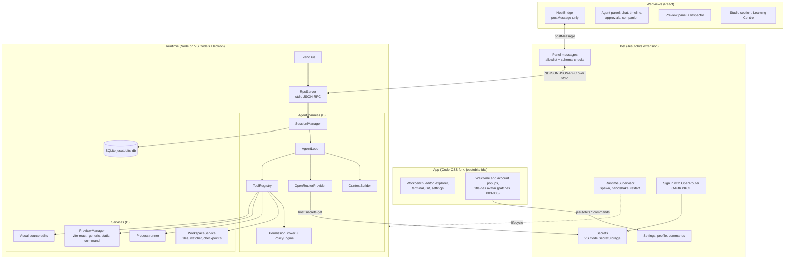
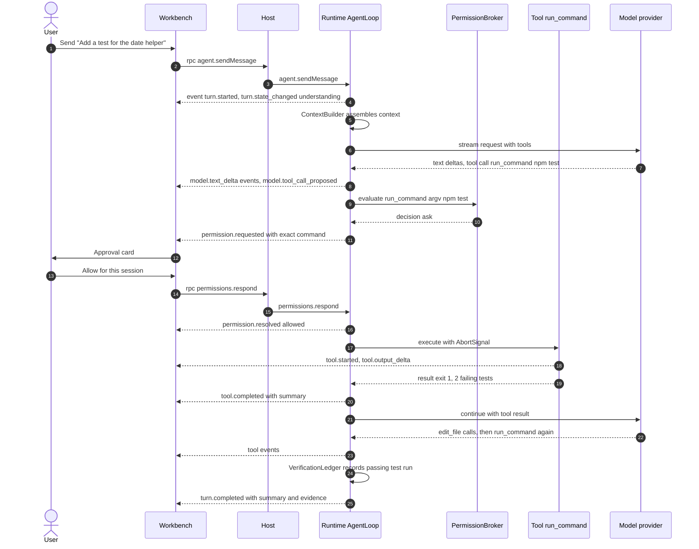
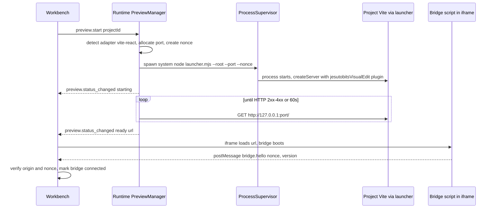
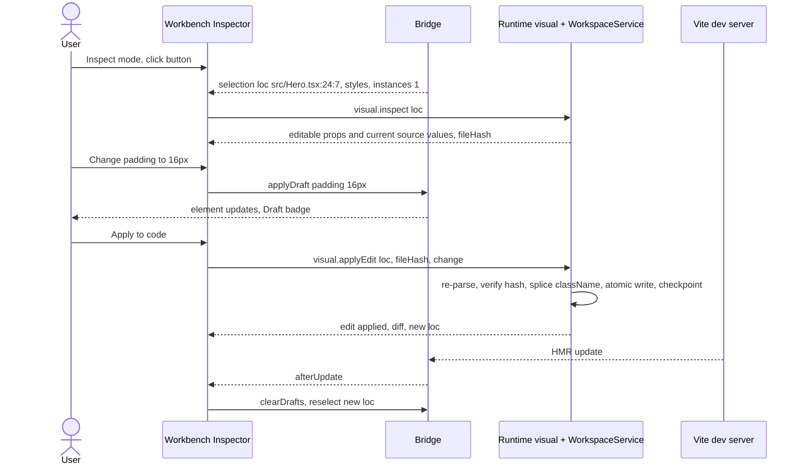
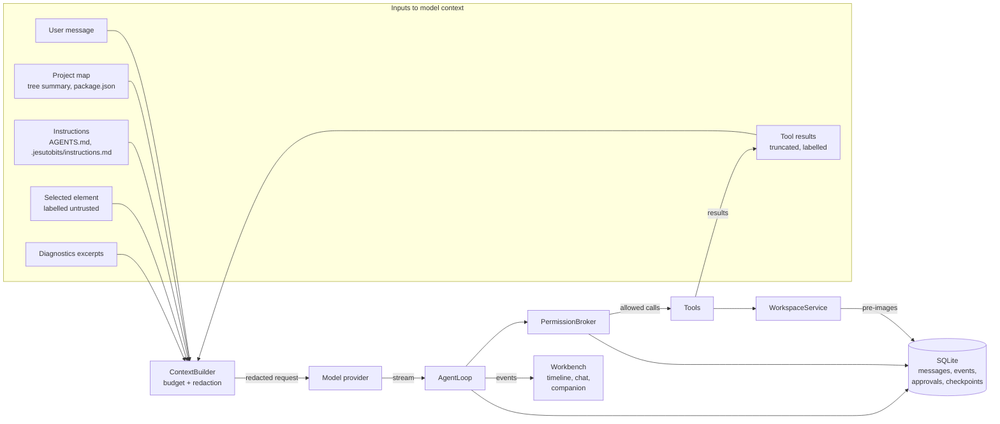

# Architecture

> Status: Agreed baseline. Decisions are recorded in `docs/DECISIONS/`. Facts are referenced as `RN-xx` (see RESEARCH_NOTES.md).

> **Since ADR-0015 (0.3.0):** Jesutobits is a Code-OSS fork. Sections 1 to 5 and 11 describe the fork. Later sections still name some Tauri-era parts when they explain a contract that carried over; read "Host" as the Jesutobits extension (`apps/vscode-extension/src`), "Workbench" as VS Code's window plus the Jesutobits webviews (`apps/vscode-extension/webview`), "Tauri IPC" as webview `postMessage` checked against `packages/protocol/src/webview.ts`, and "Node sidecar" as the runtime process on VS Code's Electron. The Tauri app is archived at tag `tauri-final`.

## 1. Goals and shape

Jesutobits is a desktop application built on Code-OSS (ADR-0015), made of **three parts and two kinds of guest content**:

| Part | Technology | Role |
|---|---|---|
| **App** | Code-OSS 1.143.1 with Jesutobits' patches and branding (the `jesutobits-ide` repository) | Window, editor, explorer, terminal, Git, settings, colour themes, the welcome and account popups, the Studio layout |
| **Host** | The Jesutobits VS Code extension (`apps/vscode-extension/src`), built in | Supervises the runtime, credentials (VS Code SecretStorage), settings, the webview relay and its allowlist, Sign in with OpenRouter |
| **Runtime** | A Node process on VS Code's Electron (`ELECTRON_RUN_AS_NODE`), TypeScript | Agent harness, tools, permissions, sessions, workspace I/O, processes, previews |

The Jesutobits UI the user sees (agent panel, preview panel, Studio section, Learning Centre) is React in VS Code webviews (`apps/vscode-extension/webview`).

| Guest content | Where it runs | Trust |
|---|---|---|
| **User project app** (preview) | Dev server child process or Jesutobits' static server + cross-origin iframe | Untrusted |
| **Extensions** | VS Code extensions from Open VSX (VS Code's mechanism); Jesutobits packs are declarative files (Stage 1) | Untrusted |

Design goals, in priority order:

1. **Enforced boundaries**: the model, the preview and extensions can only act through code paths that check permissions.
2. **Replaceable edges**: provider (OpenRouter), animation renderer and preview strategies sit behind interfaces; the runtime never depends on VS Code, so another shell could host it.
3. **Few moving parts**: one runtime process, one database, no microservices. The only local servers of our own are loopback-only: the static-site preview and the one-off Sign in with OpenRouter callback.
4. **Honest UI**: the Workbench renders runtime events; it does not simulate activity.

## 2. System context


The only outbound connections Jesutobits itself makes are to the configured model provider. All other network traffic comes from user-approved commands (for example `npm install`) or from the user's own app running in the preview (NFR-015).

## 3. The five required boundaries

| Boundary | Lives in | Owns | Must never |
|---|---|---|---|
| **A. Desktop application** | The app (VS Code), the Host extension and its webviews | Windows, layout, rendering, user input, approvals UI, settings, credential storage (Host, SecretStorage), terminals (VS Code) | Execute tools, call model providers for the agent, read project files directly from a webview |
| **B. Agent harness / runtime** | `packages/runtime`: `agent/`, `providers/`, `tools/`, `permissions/`, `context/`, `sessions/`, `verify/` | Model calls, agent loop, tool registry, permission decisions, context, verification, session persistence | Render UI, hold credentials on disk, bypass the permission broker |
| **C. User projects** | Ordinary folders anywhere | Their own code, config, Git history | Be modified except via Workspace Service writes (tools or user actions) or approved commands |
| **D. Preview and execution services** | `packages/services`: `workspace/`, `process/`, `preview/` (detection, readiness, static server), `visual/`; guest-side packages `preview-launcher`, `vite-plugin`, `visual-bridge` | File I/O with checkpoints, managed processes, dev servers, the static-site server, readiness, logs (Git and headless checks: Phase 3) | Decide permissions (they ask the broker or are called by tools that did) |
| **E. Extension ecosystem** | VS Code extensions: VS Code's own mechanism (ADR-0015). Jesutobits packs: themes and companion skins as data (Stage 1) | Packs, validation, theme tokens, skins | Execute pack content; reach secrets, files, terminal or network through Jesutobits |

B and D share one process in the MVP (the runtime) but are **separate packages** with a one-way dependency: `agent` depends on `services` through narrow interfaces; services never import agent code. If stability requires it later, services can move to a second sidecar without changing the agent (section 12).

## 4. Component diagram



## 5. Module responsibilities

### 5.1 Host (`apps/vscode-extension/src`)

| Module | Responsibility | Key rules |
|---|---|---|
| `runtime/` (`supervisor`, `connection`, `launch`, `restart-policy`) | Start the runtime on VS Code's Electron (`ELECTRON_RUN_AS_NODE`), handshake, restart with backoff, stop it on deactivate | Only module that spawns the runtime |
| `host/panel-messages` | Relay the webviews' calls to the runtime and its events back; answer host operations | Accepts only methods allowlisted in `packages/protocol/src/webview.ts`, schema-checked (invariant 4) |
| `host/reverse-calls` | Answer the runtime's `host.*` calls: secrets, trash, reveal, logs | Returns a secret only to the runtime over stdio, never to a webview |
| `host/openrouter-auth` | Sign in with OpenRouter (OAuth PKCE on a one-off loopback callback) | The key goes straight to SecretStorage (SECURITY.md section 3) |
| `host/runtime-config`, `host/workspace-project` | Map `jesutobits.*` settings to `runtime.configure`; open the workspace folder as the project, following Workspace Trust | Settings are validated against `packages/protocol` |
| `host/profile`, `host/look`, `host/new-project` | The local profile (name, picture), theme remix, New Project | Profile data stays on the computer |
| `vscode/` | The agent view, preview panel, Studio view, Learning Centre and Studio commands | Webviews get a strict CSP and a nonce |
| `extension.ts` | Activation: wires the above, registers commands (`jesutobits.*`) used by the menus and by the fork's popups | The popups only learn whether a key exists, never the key |

### 5.2 Webviews (`apps/vscode-extension/webview/src`)

| Module | Responsibility |
|---|---|
| `host-bridge/` | The `HostBridge` interface and its `postMessage` implementation; a `MockHostBridge` for tests |
| `state/` | Stores built from runtime events (project, UI) |
| `features/agent` | Chat, plan checklist, approval cards, turn summaries, timeline, Sign in with OpenRouter buttons |
| `features/companion` | The companion and its skins (COMPANION_SYSTEM.md) |
| `features/look` | The theme picker and Change the Look |
| `features/studio`, `features/learn` | The Studio side-bar section and the Learning Centre |
| `preview/` | The preview panel: iframe, toolbar, start command form, output view, bridge client, Inspector |
| `ui/`, `themes/`, `i18n/` | Shared components styled with `--vscode-*` variables, Studio palettes, strings |

### 5.3 Runtime process: harness (`packages/runtime`, boundary B)

| Module | Responsibility |
|---|---|
| `main.ts` | Process entry: stdio wiring, dependency injection of services, shutdown handling |
| `rpc/` | Stdio JSON-RPC server, schema validation, method routing, reverse-call client for `host.*` |
| `sessions/` | Session lifecycle, persistence of messages and events, interrupted-turn recovery |
| `agent/` | `AgentLoop`, turn state machine, limits, loop detection, summaries (AGENT_HARNESS.md section 3) |
| `context/` | `ContextBuilder`, instructions loading, token estimation, compaction |
| `providers/` | `ModelProvider` contract, `OpenRouterAdapter`, `ScriptedProvider` for tests, model capability cache |
| `tools/` | `ToolRegistry` and built-in tools |
| `permissions/` | `PermissionBroker`, `PolicyEngine`, command classifier, rules and script fingerprints, approval waiting |
| `verify/` | `VerificationLedger`, check profiles, output parsers (tsc, eslint, vitest, vite) |
| `events/` | `EventBus`, sequence numbers, ring buffer, persistence of turn events |
| `storage/` | `Database` interface, `node:sqlite` implementation, migrations |
| `extensions/` | `extensions.validate` method backed by `packages/extension-schema` |
| `log/` | Structured logger with redaction |

### 5.4 Runtime process: services (`packages/services`, boundary D)

| Module | Responsibility |
|---|---|
| `workspace/` | `WorkspaceService`: path guard, confined file I/O, atomic writes, watcher, ignore rules, checkpoints (ADR-0012) |
| `process/` | `ProcessSupervisor`: spawning rules, output capture, timeouts, tree kill, orphan ledger (ADR-0011) |
| `preview/` | `PreviewManager`, `PreviewAdapter` implementations (`vite-react`, `generic`), port allocation, readiness |
| `git/` | `GitService` wrapping the Git CLI with structured parsing |
| `visual/` | Editability analysis and `SourceTransformer` for visual edits (VISUAL_EDITING.md sections 7 and 8) |
| `headless/` | `playwright-core` driver used by `check_preview` (ADR-0010) |

## 6. Communication and contracts

### 6.1 Channels

| From → To | Mechanism | Content |
|---|---|---|
| Workbench → Host | Tauri `invoke` | `rpc_call`, `runtime_subscribe`, `runtime_restart`, `workbench_log`, `workbench_ready` (startup timing), `settings_get/update/subscribe`, `ui_state_get/update`, `host_notices`, `pty_*`, `settings_*`, `secrets_set/delete` (write-only), `extensions_*`, `dialog_*` |
| Host → Workbench | Tauri `Channel` | Runtime events, runtime status (`RuntimeStatusUpdate` in `packages/protocol`), PTY output, settings changes |
| Host ↔ Runtime | NDJSON JSON-RPC 2.0 over stdio (ADR-0003) | Runtime methods, events, `host.*` reverse calls |
| Workbench ↔ Preview iframe | `window.postMessage` with origin + nonce + Zod | Bridge protocol (VISUAL_EDITING.md section 9) |
| Runtime → Headless browser | Playwright (CDP) | Checks, screenshots |
| Runtime → Provider | HTTPS + SSE | Model requests |

Note that the Workbench can **write** a secret (onboarding) but has no command to **read** one back.

### 6.2 `HostBridge` (Workbench side)

```ts
// apps/desktop/src/host-bridge/types.ts
export interface HostBridge {
  rpc<M extends WorkbenchMethod>(method: M, params: MethodParams<M>): Promise<MethodResult<M>>;
  onRuntimeEvent(handler: (e: RuntimeEvent) => void): Unsubscribe;
  onRuntimeStatus(handler: (s: RuntimeStatusUpdate) => void): Unsubscribe; // starting | ready | degraded | restarting | failed, plus detail
  restartRuntime(): Promise<void>; // from failed only (ADR-0002)
  log(level: LogLevel, message: string): void; // Workbench log, written by the Host (section 10)
  reportReady(): void; // first screen rendered; the Host logs the cold-start time (NFR-001)

  secrets: {
    set(ref: SecretRef, value: string): Promise<void>;
    delete(ref: SecretRef): Promise<void>;
    exists(ref: SecretRef): Promise<boolean>;
  };
  pty: {
    open(opts: { projectId: string; cwd: string; shell?: string; cols: number; rows: number }): Promise<PtyId>;
    write(id: PtyId, data: string): Promise<void>;
    resize(id: PtyId, cols: number, rows: number): Promise<void>;
    close(id: PtyId): Promise<void>;
    onData(id: PtyId, handler: (chunk: string) => void): Unsubscribe;
  };
  settings: {
    get(): Promise<AppSettings>;
    update(patch: DeepPartial<AppSettings>): Promise<AppSettings>;
    onChange(handler: (s: AppSettings) => void): Unsubscribe;
  };
  uiState: { get(): Promise<UiState>; update(patch: Record<string, unknown>): Promise<UiState> }; // `window` is the Host's
  notices(): Promise<HostNotice[]>; // startup notices about the settings files
  dialogs: { pickFolder(opts?: { title?: string; defaultPath?: string }): Promise<string | null> };
  extensions: {
    list(): Promise<InstalledExtension[]>;
    installFromFile(path: string): Promise<InstallReport>;
    installUnpacked(path: string): Promise<InstallReport>; // developer mode only
    setEnabled(id: string, enabled: boolean): Promise<void>;
    uninstall(id: string): Promise<void>;
    assetUrl(id: string, path: string): string; // jesutobits-ext://...
  };
  app: { restart(opts?: { safeMode?: boolean }): Promise<void>; version(): Promise<string> };
}
```

### 6.3 Runtime method catalogue (Workbench-callable)

All methods are defined with Zod in `packages/protocol/src/methods/`. Names are stable; params evolve additively.

| Namespace | Methods |
|---|---|
| `runtime` | `initialize`, `configure` and `shutdown` (Host only); `ping` (Host health checks, and the Workbench for relay latency). The Host sends `configure` (the `providers`, `agent` and `privacy` settings, and its own config and log folders) after every handshake, before reporting Ready, and after every settings change |
| `projects` | `list`, `open` (by path or ID), `create`, `close`, `setTrust`, `remove`, `locate`, `detect` (package manager, scripts, preview strategy, visual-editing level: VISUAL_EDITING.md section 3), `prepareWorkspaceFolder` (creates the default folder for new projects when the user confirms it, FR-002) |
| `toolchain` | `detect` (Git, Node.js and package managers with versions, FR-010) |
| `fs` | `listDir`, `readFile`, `writeFile` (requires `expectedHash`), `createFile`, `createDirectory`, `rename`, `stat`, `quickOpen`, `trash` (the runtime confines the path, the Host moves it to the OS trash: ADR-0014), `search` (ripgrep through the bundled sidecar, Phase 2). All act on the active project and fail with `fs.no_project` without one |
| `sessions` | `list`, `create`, `get`, `history` (pages of the session's stored events), `rename`, `archive`, `delete`, `export` (later, FR-170) |
| `agent` | `sendMessage`, `cancelTurn`, `pauseTurn`, `resumeTurn`, `retryTurn`, `answerQuestion`, `setModel` |
| `permissions` | `respond`, `listRules`, `addRule` (Phase 3, project rules for checks and dev servers), `removeRule`, `getPolicy`, `setPolicy` |
| `checkpoints` | `listForTurn`, `revertTurn`, `revertFile` |
| `preview` | `start`, `stop`, `restart`, `status`, `logs`, `setViewport` |
| `visual` | `inspect` (source analysis for a selection), `applyEdit`, `undoEdit` |
| `git` | `status`, `diff`, `commit`, `log` |
| `models` | `list` (with `refresh: true` to fetch again), `testConnection` |
| `events` | `replay` |
| `extensions` | `validate` (called by the Host during install, and by the Workbench for developer-mode reloads) |

Reverse methods the runtime may call: `host.fs.trash` and `host.os.reveal` (ADR-0014), `host.secrets.get`, `host.log`, `host.notify` (OS notification when the window is unfocused and approval is needed). They are declared in `packages/protocol/src/reverse.ts` (`REVERSE_METHODS`); the Host answers only those, on their own task, and refuses anything else.

### 6.4 Runtime event envelope

```ts
// packages/protocol/src/events.ts (sketch)
export const RuntimeEventBase = z.object({
  seq: z.number().int().nonnegative(),       // per runtime process, strictly increasing
  ts: z.string().datetime(),
  type: z.string(),                          // discriminator, see catalogue
  projectId: z.string().optional(),
  sessionId: z.string().optional(),
  turnId: z.string().optional(),
  callId: z.string().optional(),             // tool call
  processId: z.string().optional(),          // managed process
});
```

Event catalogue (full payloads in AGENT_HARNESS.md section 8):

| Family | Types |
|---|---|
| Session | `session.updated` |
| Turn | `turn.started`, `turn.state_changed`, `turn.completed`, `turn.failed`, `turn.cancelled`, `turn.interrupted` (stored at startup, never sent live) |
| Model | `model.request_started`, `model.text_delta`, `model.reasoning_delta`, `model.step_completed` (a step's full text and the tools it called), `model.usage`, `model.error` |
| Plan | `plan.updated` |
| Tool | `tool.started`, `tool.output_delta` (Phase 3), `tool.completed` (`ok: false` for failures, denials and blocked actions) |
| Permission | `permission.requested`, `permission.resolved` |
| Question | `question.asked`, `question.answered` |
| Process | `process.started`, `process.output`, `process.exited` |
| Preview | `preview.status_changed`, `preview.log`, `preview.reloaded` |
| Workspace | `fs.changed` (debounced batches), `checkpoint.recorded` |
| Verification | `check.started`, `check.completed` |
| Runtime | `runtime.warning`, `runtime.error` |

Each event type is declared with `defineEvent` in `packages/protocol/src/events.ts` (its own fields sit next to the base fields, and unknown fields are rejected) and registered in `EVENTS`; `pnpm gen` writes a JSON Schema per event. The runtime's `EventBus` (`packages/runtime/src/events/`) assigns `seq`, checks every event against its schema before sending it, and keeps the last 2,000 events for `events.replay`, which reports `complete: false` when a gap is older than the buffer (the Workbench then reloads that state from its owning methods).

Agent events are also stored with their session, except text and reasoning deltas (`TRANSIENT_EVENT_TYPES`); `sessions.history` returns them, and the Workbench folds stored and live events through the same reducer.

The Workbench derives **everything** it shows about agent activity (timeline rows, status bar, companion state) from these events. No component invents activity.

### 6.5 Identifiers

All IDs are ULIDs with a type prefix: `prj_`, `ses_`, `trn_`, `call_`, `perm_`, `proc_`, `prv_`, `sel_`, `chk_`, `ext_`. Prefixes make logs readable and prevent cross-type mistakes.

## 7. Key sequences

### 7.1 Agent turn with a tool call that needs approval



### 7.2 Preview start (instrumented)



### 7.3 Persistent visual edit



## 8. Data flows



Redaction happens in two places: the `ContextBuilder` (before anything reaches the provider) and the logger (before anything reaches disk). Both use the same `SecretRegistry`, which holds the values of known secrets in memory so they can be masked wherever they appear (SECURITY.md section 6).

## 9. Error handling strategy

### 9.1 Error taxonomy

Every error that crosses a module or process boundary is a `JesutobitsError`:

```ts
export interface JesutobitsError {
  code: JesutobitsErrorCode;          // stable string, e.g. "fs.outside_workspace"
  message: string;              // safe for UI, no secrets
  retryable: boolean;
  userAction?: "retry" | "open_settings" | "check_credits" | "approve" | "reinstall" | "report";
  details?: Record<string, unknown>; // redacted, for the timeline "details" view
  cause?: { code?: string; message: string }; // internal chain, redacted
}
```

Code families: `rpc.*`, `runtime.*`, `provider.*`, `tool.*`, `fs.*`, `process.*`, `preview.*`, `visual.*`, `git.*`, `permission.*`, `ext.*`, `storage.*`.

### 9.2 Rules by layer

| Layer | Rule |
|---|---|
| Tools | Never throw to the loop. Return `ToolResult` with `ok: false` and a `ToolError`; the model sees a short, factual message. |
| Agent loop | Distinguishes model-recoverable errors (tool failed, invalid input) from turn-fatal errors (credentials, budget, cancelled). Fatal errors end the turn with `turn.failed`. |
| Providers | Map every failure to `ProviderError` categories (AGENT_HARNESS.md section 2.5). |
| Services | Throw typed `JesutobitsError`s. Process exits are results, not errors. |
| RPC | Every JSON-RPC error carries `data: JesutobitsError`. Method failures: `-32000`. Invalid JSON: `-32700`. Invalid envelope or oversized message: `-32600`. Unknown methods: `-32601`. Schema failures: `-32602`. Unexpected handler errors: `-32603` with a generic message (details go to the log only). |
| Workbench | Errors render where the user was acting (inline for forms, timeline for agent, toast for background). Every error offers the `userAction` when present. |
| Host | Runtime crash → status `restarting` banner; repeated crash → `failed` screen with log location and Restart button. |

### 9.3 Invariants that survive errors

- File writes are atomic (temp file in the same directory, `fsync`, rename). A crash never leaves a half-written file.
- The approval state is persisted before a tool executes, so an approved call is not re-run after a crash without asking again.
- A turn interrupted by a crash is marked `interrupted` on the next start; its tools are not resumed automatically.

## 10. Logging and observability

- **Format:** JSON lines. Fields: `ts`, `level`, `component` (`host`, `runtime`, `workbench`), `module`, `msg`, plus correlation IDs (`projectId`, `sessionId`, `turnId`, `callId`, `processId`) and `err` (a `JesutobitsError`).
- **Files:** `logs/host.jsonl`, `logs/runtime.jsonl`, `logs/workbench.jsonl`, rotated at 10 MB, 10 files each (NFR-014). The Host is the single writer of all three (`apps/desktop/src-tauri/src/logging/`): the Workbench logs through `workbench_log`, and the runtime writes JSON lines to **stderr**, which the Host copies into `runtime.jsonl`. Stderr lines that are not a JSON object with `level` and `msg` (for example Node's own crash output) are kept as `warn` lines from module `stderr`, so a crash is never lost. The Host stamps `ts` and `component` itself.
- **Runtime side:** `packages/runtime/src/log/` writes one JSON object per line to stderr (`level`, `msg`, `module` and any fields; `JESUTOBITS_RUNTIME_LOG` sets the level). `services` code receives the same `Logger` interface (`@jesutobits/shared`) by injection, since it may not depend on the runtime or use `console`.
- **Redaction:** all log calls pass through the `SecretRegistry` masker. The Host masks every string value of every line again before writing (registered secret values, then the token patterns of SECURITY.md section 6.1); `fixtures/redaction/cases.json` holds the pattern cases both implementations must pass. Model prompts and completions are **not** logged by default; a "Debug: log model traffic" setting enables it with redaction and a warning.
- **Levels:** `error`, `warn`, `info` (default), `debug` (setting), `trace` (env var only: `JESUTOBITS_HOST_LOG`, `JESUTOBITS_RUNTIME_LOG`). Each process filters its own lines; the Workbench cannot log at `trace`.
- **In-app diagnostics:** Help > Diagnostics shows runtime status, versions, last 200 log lines with filters, process table (managed processes with PIDs), and "Copy diagnostic bundle" (zips redacted logs and environment summary for bug reports, saved locally; nothing uploaded).
- **Startup:** every launch logs its stages in `host.jsonl` (`spawnMs`, the runtime's `nodeBootstrapMs`, `mainStartMs`, `initializeReceivedMs`, and `sinceHostStartMs` when the Workbench first renders), so a slow start can be explained after the fact (docs/spikes/S1.md section 1.1).
- **Metrics:** local counters only (turn durations, tool durations, relay latency, crash counts) stored in SQLite for the diagnostics page. No telemetry (NFR-015).

## 11. Cross-platform considerations

Since 0.3.0 the app is built for Windows x64, Linux x64 and macOS (Apple Silicon and Intel) by the `jesutobits-ide` CI, following VS Code's own release pipelines. VS Code supplies the per-platform window, webview (Chromium in every case), terminal and credential store, so most differences are handled for us. What Jesutobits' own code must respect:

| Concern | Windows | macOS | Linux | Rule |
|---|---|---|---|---|
| Paths | `\`, drive letters, case-insensitive | `/`, usually case-insensitive | `/`, case-sensitive | Always `node:path`; compare canonical real paths |
| Spawning | `.cmd` shims need the shared spawner | Plain `spawn` | Plain `spawn` | Every spawn goes through `ProcessSupervisor` / `startProcess` |
| Process trees | Kill the whole tree (`taskkill /T`) | Process groups | Process groups | Cancellation stops the tree within 2 s |
| Credentials | Windows Credential Manager | Keychain | GNOME Keyring or KWallet (VS Code falls back without one) | Only through VS Code SecretStorage |
| Line endings | Preserve CRLF where files use it | LF | LF | Never rewrite line endings |
| Packages | Per-user installer (unsigned) | `.dmg`/`.zip`, signed ad hoc | `.deb`, `.rpm`, `.tar.gz` | `jesutobits-ide/scripts/build.mjs --target` |

Tests run on Windows and Ubuntu in CI; macOS has no hand test yet (ROADMAP section 5).

## 12. Deferred architecture

| Topic | Current decision | Path forward |
|---|---|---|
| Multiple windows | One window, one active project (FR-012) | One runtime per app, sessions already keyed by project; windows would subscribe to project-filtered event streams |
| Services in a separate process | Same process as the agent | Move `packages/services` behind its own stdio RPC if crash isolation is needed |
| Multiple previews per project | One | `PreviewManager` already keys sessions by `prv_` ID |
| Remote or cloud runtime | Not planned | The stdio protocol could run over a secure tunnel; requires a new trust model |
| OS-level sandboxing of agent commands | Not in MVP | Evaluate Windows AppContainer, macOS sandbox profiles, Linux bubblewrap/Landlock; the `ProcessSupervisor` is the single integration point |
