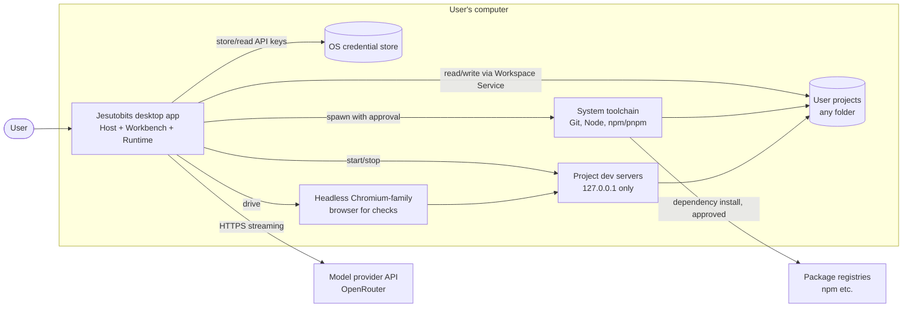
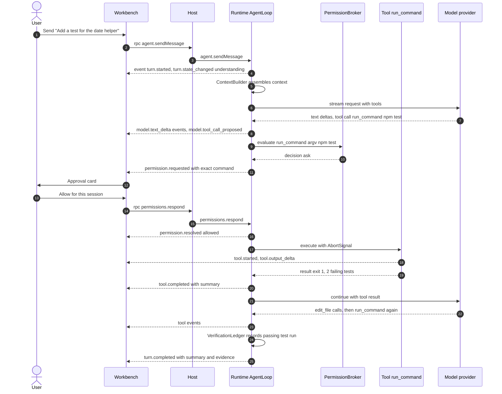
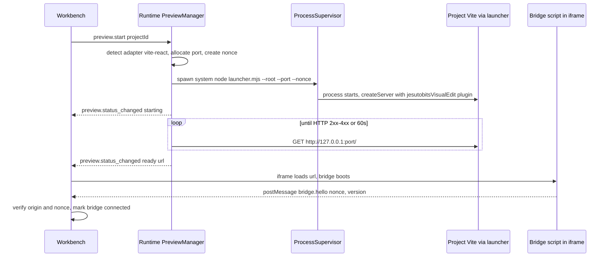
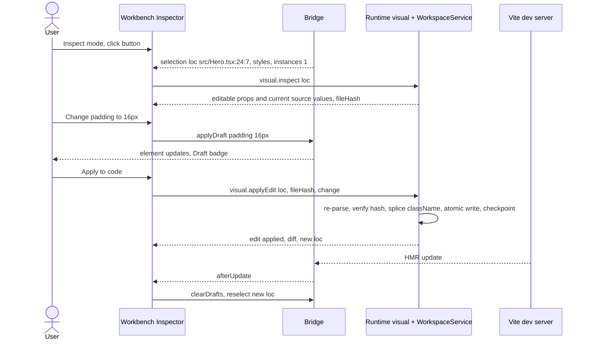
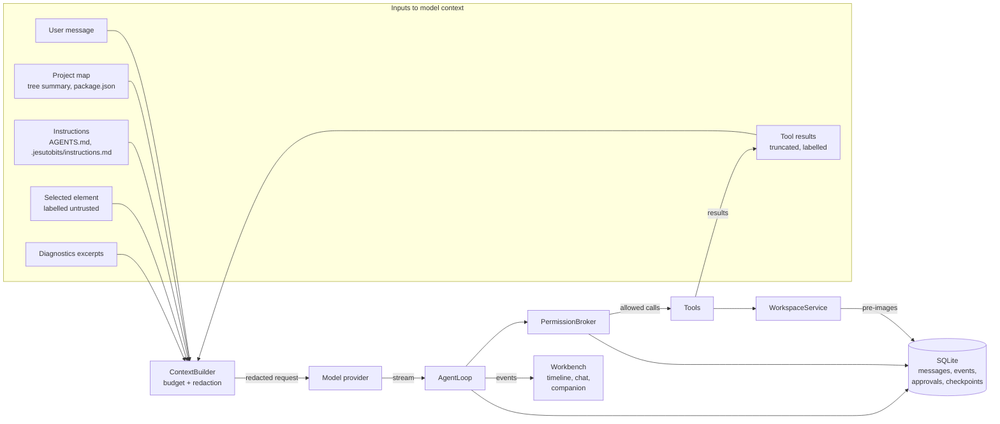

# Architecture

> Status: Agreed baseline. Decisions are recorded in `docs/DECISIONS/`. Facts are referenced as `RN-xx` (see RESEARCH_NOTES.md).

## 1. Goals and shape

Jesutobits is a desktop application made of **three processes and two kinds of guest content**:

| Process | Technology | Role |
|---|---|---|
| **Host** | Tauri 2, Rust | Window, OS integration, credential store, process lifecycle, PTYs, extension file serving, IPC relay and allowlist |
| **Workbench** | React + TypeScript + Tailwind in the OS webview | Everything the user sees and touches |
| **Runtime** | Node.js sidecar (bundled), TypeScript | Agent harness, tools, permissions, sessions, workspace I/O, processes, previews |

| Guest content | Where it runs | Trust |
|---|---|---|
| **User project app** (preview) | Dev server child process + cross-origin iframe | Untrusted |
| **Extensions** | Declarative files (Stage 1); sandboxed iframes (Stage 2, later); separate MCP processes (Stage 3, later) | Untrusted |

Design goals, in priority order:

1. **Enforced boundaries**: the model, the preview and extensions can only act through code paths that check permissions.
2. **Replaceable edges**: shell (Tauri), provider (OpenRouter), editor (Monaco), animation renderer and preview adapters sit behind interfaces.
3. **Few moving parts**: three processes, one database, no local web servers of our own, no microservices.
4. **Honest UI**: the Workbench renders runtime events; it does not simulate activity.

## 2. System context



The only outbound connections Jesutobits itself makes are to the configured model provider. All other network traffic comes from user-approved commands (for example `npm install`) or from the user's own app running in the preview (NFR-015).

## 3. The five required boundaries

| Boundary | Lives in | Owns | Must never |
|---|---|---|---|
| **A. Desktop application** | Host + Workbench | Windows, layout, rendering, user input, approvals UI, settings UI, credential storage (Host), PTYs (Host), extension loading | Execute tools, call model providers, read project files directly |
| **B. Agent harness / runtime** | `packages/runtime`: `agent/`, `providers/`, `tools/`, `permissions/`, `context/`, `sessions/`, `verify/` | Model calls, agent loop, tool registry, permission decisions, context, verification, session persistence | Render UI, hold credentials on disk, bypass the permission broker |
| **C. User projects** | Ordinary folders anywhere | Their own code, config, Git history | Be modified except via Workspace Service writes (tools or user actions) or approved commands |
| **D. Preview and execution services** | `packages/services`: `workspace/`, `process/`, `preview/`, `git/`, `visual/`, `headless/`; Host: `pty_manager`; guest-side packages `preview-launcher`, `vite-plugin`, `visual-bridge` | File I/O with checkpoints, managed processes, dev servers, readiness, logs, headless checks, Git CLI wrapper, terminals | Decide permissions (they ask the broker or are called by tools that did) |
| **E. Extension ecosystem** | Host (install, file serving), Workbench (theme engine, companion, extension manager); Runtime (Stage 3 later) | Packages, validation, enable state, permissions, theme tokens, skins | Reach secrets, files, terminal or network without a granted permission |

B and D share one process in the MVP (the runtime) but are **separate packages** with a one-way dependency: `agent` depends on `services` through narrow interfaces; services never import agent code. If stability requires it later, services can move to a second sidecar without changing the agent (section 12).

## 4. Component diagram

```mermaid
flowchart TB
    subgraph host["Host (Rust, Tauri 2)"]
        H1["RuntimeSupervisor<br/>spawn, job object, restart"]
        H2["RpcRelay + MethodAllowlist"]
        H3["SecretStore<br/>keyring"]
        H4["PtyManager<br/>portable-pty"]
        H5["ExtensionStore + jesutobits-ext protocol"]
        H6["SettingsStore<br/>settings.json, ui-state.json"]
        H7["Dialogs, window, updater"]
    end

    subgraph wb["Workbench (React in OS webview)"]
        W0["HostBridge<br/>only module using Tauri APIs"]
        W1["Layout and docking"]
        W2["Explorer, Editor (Monaco), Git panel"]
        W3["Agent chat + Timeline + Approvals"]
        W4["Terminal (xterm.js)"]
        W5["Preview panel + Inspector + Overlay"]
        W6["CompanionController + Renderers"]
        W7["ThemeEngine + ExtensionManager UI"]
        W8["EventStore<br/>client-side state from runtime events"]
    end

    subgraph rt["Runtime (Node sidecar)"]
        R0["RpcServer<br/>stdio JSON-RPC"]
        subgraph harness["Agent harness (B)"]
            R1["SessionManager"]
            R2["AgentLoop"]
            R3["ContextBuilder"]
            R4["ProviderRegistry + OpenRouterAdapter"]
            R5["ToolRegistry"]
            R6["PermissionBroker + PolicyEngine"]
            R7["VerificationLedger"]
        end
        subgraph services["Services (D)"]
            S1["WorkspaceService<br/>files, watcher, checkpoints"]
            S2["ProcessSupervisor"]
            S3["PreviewManager + adapters"]
            S4["GitService"]
            S5["CheckRunner + HeadlessBrowser"]
            S6["SourceTransformer<br/>visual edits"]
        end
        R8["EventBus"]
        R9[("SQLite jesutobits.db")]
    end

    W0 <-->|invoke + Channel| H2
    H2 <-->|NDJSON JSON-RPC over stdio| R0
    H1 -.->|lifecycle| rt
    R0 --> R1
    R1 --> R2
    R2 --> R3
    R2 --> R4
    R2 --> R5
    R5 --> R6
    R5 --> S1
    R5 --> S2
    R5 --> S3
    R5 --> S4
    R5 --> S5
    R5 --> S6
    R2 --> R7
    R8 --> R0
    R1 --> R9
    R4 -->|host.secrets.get| H3
    W4 <--> H4
    W7 <--> H5
    W1 <--> H6
```



## 5. Module responsibilities

### 5.1 Host (`apps/desktop/src-tauri`)

| Module | Responsibility | Key rules |
|---|---|---|
| `runtime_supervisor` | Start the Node sidecar (ADR-0002), assign to a Windows Job Object before `initialize`, health pings every 5 s, restart with backoff, graceful shutdown | Only module that spawns the runtime |
| `rpc_relay` | Forward Workbench calls to the runtime and runtime events to Workbench Channels; answer `host.*` reverse calls | Parses envelopes only; checks `method` against the allowlist (ADR-0003) |
| `secret_store` | Save, read, delete secrets in the OS store using `keyring`. Refs look like `provider:<id>:<profile>` | Returns secrets only to the runtime over stdio, never to the Workbench |
| `pty_manager` | Open, resize, write, close PTYs; stream output to the Workbench | cwd must be a known project root; shell from settings |
| `extension_store` | Install: unpack into a staging folder with archive-safety checks (no path traversal, size caps), ask the runtime to run the full validator (`extensions.validate`), then move into a versioned folder. Packages are unsigned in the MVP. Uninstall. Serve files via `jesutobits-ext://<id>/<path>` with strict CSP | Serves only files listed as assets in the manifest |
| `settings_store` | Load, validate, migrate and save `settings.json` and `ui-state.json`; notify the runtime of relevant changes | Single writer for these files |
| `dialogs`, `window`, `updater` | OS folder picker, window state, app updates | Folder picker results go to the runtime only when the Workbench requested them |

### 5.2 Workbench (`apps/desktop/src`)

| Module | Responsibility |
|---|---|
| `host-bridge/` | The `HostBridge` interface and its Tauri implementation. A `MockHostBridge` supports browser-only development and Playwright tests. |
| `state/` | `EventStore` (normalised runtime events by session and turn), UI state. Uses a small store library (Zustand recommended). |
| `features/layout` | Dock regions, presets, persistence (UX_AND_INTERFACE.md section 4) |
| `features/explorer`, `features/editor`, `features/git` | File tree (lazy), tabs, Monaco wrapper (ADR-0004), Git panel |
| `features/agent` | Chat, plan checklist, approval cards, turn summaries, timeline |
| `features/terminal` | xterm.js sessions bound to Host PTYs |
| `features/preview` | Preview iframe, toolbar, logs view, inspect overlay, bridge messaging, properties inspector |
| `features/companion` | `CompanionController` and renderers (COMPANION_SYSTEM.md) |
| `features/appearance` | `ThemeEngine` applying token CSS variables and Monaco themes |
| `features/extensions` | Extension manager UI, validation results, safe mode banner |
| `features/onboarding`, `features/settings` | First run and settings screens |

### 5.3 Runtime process: harness (`packages/runtime`, boundary B)

| Module | Responsibility |
|---|---|
| `main.ts` | Process entry: stdio wiring, dependency injection of services, shutdown handling |
| `rpc/` | Stdio JSON-RPC server, schema validation, method routing, reverse-call client for `host.*` |
| `sessions/` | Session lifecycle, persistence of messages and events, interrupted-turn recovery |
| `agent/` | `AgentLoop`, turn state machine, limits, loop detection, summaries (AGENT_HARNESS.md section 3) |
| `context/` | `ContextBuilder`, instructions loading, token estimation, compaction |
| `providers/` | `ModelProvider` contract, `OpenRouterAdapter`, `ScriptedProvider` for tests, model capability cache |
| `tools/` | `ToolRegistry` and built-in tools |
| `permissions/` | `PermissionBroker`, `PolicyEngine`, command classifier, rules and script fingerprints, approval waiting |
| `verify/` | `VerificationLedger`, check profiles, output parsers (tsc, eslint, vitest, vite) |
| `events/` | `EventBus`, sequence numbers, ring buffer, persistence of turn events |
| `storage/` | `Database` interface, `node:sqlite` implementation, migrations |
| `extensions/` | `extensions.validate` method backed by `packages/extension-schema` |
| `log/` | Structured logger with redaction |

### 5.4 Runtime process: services (`packages/services`, boundary D)

| Module | Responsibility |
|---|---|
| `workspace/` | `WorkspaceService`: path guard, confined file I/O, atomic writes, watcher, ignore rules, checkpoints (ADR-0012) |
| `process/` | `ProcessSupervisor`: spawning rules, output capture, timeouts, tree kill, orphan ledger (ADR-0011) |
| `preview/` | `PreviewManager`, `PreviewAdapter` implementations (`vite-react`, `generic`), port allocation, readiness |
| `git/` | `GitService` wrapping the Git CLI with structured parsing |
| `visual/` | Editability analysis and `SourceTransformer` for visual edits (VISUAL_EDITING.md sections 7 and 8) |
| `headless/` | `playwright-core` driver used by `check_preview` (ADR-0010) |

## 6. Communication and contracts

### 6.1 Channels

| From → To | Mechanism | Content |
|---|---|---|
| Workbench → Host | Tauri `invoke` | `rpc_call`, `runtime_subscribe`, `workbench_log`, `pty_*`, `settings_*`, `secrets_set/delete` (write-only), `extensions_*`, `dialog_*` |
| Host → Workbench | Tauri `Channel` | Runtime events, runtime status (`RuntimeStatusUpdate` in `packages/protocol`), PTY output, settings changes |
| Host ↔ Runtime | NDJSON JSON-RPC 2.0 over stdio (ADR-0003) | Runtime methods, events, `host.*` reverse calls |
| Workbench ↔ Preview iframe | `window.postMessage` with origin + nonce + Zod | Bridge protocol (VISUAL_EDITING.md section 9) |
| Runtime → Headless browser | Playwright (CDP) | Checks, screenshots |
| Runtime → Provider | HTTPS + SSE | Model requests |

Note that the Workbench can **write** a secret (onboarding) but has no command to **read** one back.

### 6.2 `HostBridge` (Workbench side)

```ts
// apps/desktop/src/host-bridge/types.ts
export interface HostBridge {
  rpc<M extends WorkbenchMethod>(method: M, params: MethodParams<M>): Promise<MethodResult<M>>;
  onRuntimeEvent(handler: (e: RuntimeEvent) => void): Unsubscribe;
  onRuntimeStatus(handler: (s: RuntimeStatusUpdate) => void): Unsubscribe; // starting | ready | degraded | restarting | failed, plus detail
  log(level: LogLevel, message: string): void; // Workbench log, written by the Host (section 10)

  secrets: {
    set(ref: SecretRef, value: string): Promise<void>;
    delete(ref: SecretRef): Promise<void>;
    exists(ref: SecretRef): Promise<boolean>;
  };
  pty: {
    open(opts: { projectId: string; cwd: string; shell?: string; cols: number; rows: number }): Promise<PtyId>;
    write(id: PtyId, data: string): Promise<void>;
    resize(id: PtyId, cols: number, rows: number): Promise<void>;
    close(id: PtyId): Promise<void>;
    onData(id: PtyId, handler: (chunk: string) => void): Unsubscribe;
  };
  settings: {
    get(): Promise<AppSettings>;
    update(patch: DeepPartial<AppSettings>): Promise<AppSettings>;
    onChange(handler: (s: AppSettings) => void): Unsubscribe;
  };
  dialogs: { pickFolder(opts?: { title?: string; defaultPath?: string }): Promise<string | null> };
  extensions: {
    list(): Promise<InstalledExtension[]>;
    installFromFile(path: string): Promise<InstallReport>;
    installUnpacked(path: string): Promise<InstallReport>; // developer mode only
    setEnabled(id: string, enabled: boolean): Promise<void>;
    uninstall(id: string): Promise<void>;
    assetUrl(id: string, path: string): string; // jesutobits-ext://...
  };
  app: { restart(opts?: { safeMode?: boolean }): Promise<void>; version(): Promise<string> };
}
```

### 6.3 Runtime method catalogue (Workbench-callable)

All methods are defined with Zod in `packages/protocol/src/methods/`. Names are stable; params evolve additively.

| Namespace | Methods |
|---|---|
| `runtime` | `initialize` and `shutdown` (Host only); `ping` (Host health checks, and the Workbench for relay latency) |
| `projects` | `list`, `open`, `close`, `create`, `setTrust`, `detect` (toolchain, preview strategy, checks) |
| `fs` | `listDir`, `readFile`, `writeFile`, `createFile`, `rename`, `trash`, `stat`, `search`, `quickOpen` |
| `sessions` | `list`, `create`, `get`, `rename`, `archive`, `delete`, `export` |
| `agent` | `sendMessage`, `cancelTurn`, `pauseTurn`, `resumeTurn`, `retryTurn`, `answerQuestion`, `setModel` |
| `permissions` | `respond`, `listRules`, `addRule`, `removeRule`, `getPolicy`, `setPolicy` |
| `checkpoints` | `listForSession`, `revertTurn`, `revertFile` |
| `preview` | `start`, `stop`, `restart`, `status`, `logs`, `setViewport` |
| `visual` | `inspect` (source analysis for a selection), `applyEdit`, `undoEdit` |
| `git` | `status`, `diff`, `commit`, `log` |
| `models` | `list`, `testConnection`, `refresh` |
| `events` | `replay` |
| `extensions` | `validate` (called by the Host during install, and by the Workbench for developer-mode reloads) |

Reverse methods the runtime may call: `host.secrets.get`, `host.log`, `host.notify` (OS notification when the window is unfocused and approval is needed).

### 6.4 Runtime event envelope

```ts
// packages/protocol/src/events.ts (sketch)
export const RuntimeEventBase = z.object({
  seq: z.number().int().nonnegative(),       // per runtime process, strictly increasing
  ts: z.string().datetime(),
  type: z.string(),                          // discriminator, see catalogue
  projectId: z.string().optional(),
  sessionId: z.string().optional(),
  turnId: z.string().optional(),
  callId: z.string().optional(),             // tool call
  processId: z.string().optional(),          // managed process
});
```

Event catalogue (full payloads in AGENT_HARNESS.md section 8):

| Family | Types |
|---|---|
| Turn | `turn.started`, `turn.state_changed`, `turn.completed`, `turn.failed`, `turn.cancelled`, `turn.interrupted` |
| Model | `model.request_started`, `model.text_delta`, `model.reasoning_delta`, `model.tool_call_proposed`, `model.usage`, `model.error` |
| Plan | `plan.updated` |
| Tool | `tool.started`, `tool.output_delta`, `tool.completed`, `tool.failed` |
| Permission | `permission.requested`, `permission.resolved` |
| Question | `question.asked`, `question.answered` |
| Process | `process.started`, `process.output`, `process.exited` |
| Preview | `preview.status_changed`, `preview.log`, `preview.reloaded` |
| Workspace | `fs.changed` (debounced batches), `checkpoint.recorded` |
| Verification | `check.started`, `check.completed` |
| Runtime | `runtime.warning`, `runtime.error` |

The Workbench derives **everything** it shows about agent activity (timeline rows, status bar, companion state) from these events. No component invents activity.

### 6.5 Identifiers

All IDs are ULIDs with a type prefix: `prj_`, `ses_`, `trn_`, `call_`, `perm_`, `proc_`, `prv_`, `sel_`, `chk_`, `ext_`. Prefixes make logs readable and prevent cross-type mistakes.

## 7. Key sequences

### 7.1 Agent turn with a tool call that needs approval



### 7.2 Preview start (instrumented)



### 7.3 Persistent visual edit



## 8. Data flows



Redaction happens in two places: the `ContextBuilder` (before anything reaches the provider) and the logger (before anything reaches disk). Both use the same `SecretRegistry`, which holds the values of known secrets in memory so they can be masked wherever they appear (SECURITY.md section 6).

## 9. Error handling strategy

### 9.1 Error taxonomy

Every error that crosses a module or process boundary is a `JesutobitsError`:

```ts
export interface JesutobitsError {
  code: JesutobitsErrorCode;          // stable string, e.g. "fs.outside_workspace"
  message: string;              // safe for UI, no secrets
  retryable: boolean;
  userAction?: "retry" | "open_settings" | "check_credits" | "approve" | "reinstall" | "report";
  details?: Record<string, unknown>; // redacted, for the timeline "details" view
  cause?: { code?: string; message: string }; // internal chain, redacted
}
```

Code families: `rpc.*`, `runtime.*`, `provider.*`, `tool.*`, `fs.*`, `process.*`, `preview.*`, `visual.*`, `git.*`, `permission.*`, `ext.*`, `storage.*`.

### 9.2 Rules by layer

| Layer | Rule |
|---|---|
| Tools | Never throw to the loop. Return `ToolResult` with `ok: false` and a `ToolError`; the model sees a short, factual message. |
| Agent loop | Distinguishes model-recoverable errors (tool failed, invalid input) from turn-fatal errors (credentials, budget, cancelled). Fatal errors end the turn with `turn.failed`. |
| Providers | Map every failure to `ProviderError` categories (AGENT_HARNESS.md section 2.5). |
| Services | Throw typed `JesutobitsError`s. Process exits are results, not errors. |
| RPC | Every JSON-RPC error carries `data: JesutobitsError`. Method failures: `-32000`. Invalid JSON: `-32700`. Invalid envelope or oversized message: `-32600`. Unknown methods: `-32601`. Schema failures: `-32602`. Unexpected handler errors: `-32603` with a generic message (details go to the log only). |
| Workbench | Errors render where the user was acting (inline for forms, timeline for agent, toast for background). Every error offers the `userAction` when present. |
| Host | Runtime crash → status `restarting` banner; repeated crash → `failed` screen with log location and Restart button. |

### 9.3 Invariants that survive errors

- File writes are atomic (temp file in the same directory, `fsync`, rename). A crash never leaves a half-written file.
- The approval state is persisted before a tool executes, so an approved call is not re-run after a crash without asking again.
- A turn interrupted by a crash is marked `interrupted` on the next start; its tools are not resumed automatically.

## 10. Logging and observability

- **Format:** JSON lines. Fields: `ts`, `level`, `component` (`host`, `runtime`, `workbench`), `module`, `msg`, plus correlation IDs (`projectId`, `sessionId`, `turnId`, `callId`, `processId`) and `err` (a `JesutobitsError`).
- **Files:** `logs/host.jsonl`, `logs/runtime.jsonl`, `logs/workbench.jsonl`, rotated at 10 MB, 10 files each (NFR-014). The Host is the single writer of all three (`apps/desktop/src-tauri/src/logging/`): the Workbench logs through `workbench_log`, and the runtime writes JSON lines to **stderr**, which the Host copies into `runtime.jsonl`. Stderr lines that are not a JSON object with `level` and `msg` (for example Node's own crash output) are kept as `warn` lines from module `stderr`, so a crash is never lost. The Host stamps `ts` and `component` itself.
- **Redaction:** all log calls pass through the `SecretRegistry` masker. The Host masks every string value of every line again before writing (registered secret values, then the token patterns of SECURITY.md section 6.1); `fixtures/redaction/cases.json` holds the pattern cases both implementations must pass. Model prompts and completions are **not** logged by default; a "Debug: log model traffic" setting enables it with redaction and a warning.
- **Levels:** `error`, `warn`, `info` (default), `debug` (setting), `trace` (env var only: `JESUTOBITS_HOST_LOG`, `JESUTOBITS_RUNTIME_LOG`). Each process filters its own lines; the Workbench cannot log at `trace`.
- **In-app diagnostics:** Help > Diagnostics shows runtime status, versions, last 200 log lines with filters, process table (managed processes with PIDs), and "Copy diagnostic bundle" (zips redacted logs and environment summary for bug reports, saved locally; nothing uploaded).
- **Metrics:** local counters only (turn durations, tool durations, relay latency, crash counts) stored in SQLite for the diagnostics page. No telemetry (NFR-015).

## 11. Cross-platform considerations

The MVP targets Windows. The table lists what code must already respect so macOS and Linux need no redesign.

| Concern | Windows (MVP) | macOS | Linux | Rule now |
|---|---|---|---|---|
| Paths | Backslashes, drive letters, case-insensitive, 260-char legacy limit, reserved names (`CON`, `NUL`) | Case-insensitive by default | Case-sensitive | Use `node:path` and `std::path` only; canonicalise; compare with platform-aware equality; reject reserved names in file tools |
| Symlinks | Junctions and symlinks (symlink creation may need privileges) | Symlinks | Symlinks | Path guard resolves real paths before confinement checks |
| Shell for terminals | PowerShell 7 if present, else Windows PowerShell; `cmd.exe` option | User login shell (`zsh` default) | `$SHELL` | Shell is a setting with detected default |
| Spawning shims | `.cmd` needs shell (RN-16) | n/a | n/a | One spawner module handles it |
| Process trees | Job Objects, `taskkill /T` | Process groups | Process groups | ADR-0011 |
| Secure storage | Credential Manager | Keychain | Secret Service (may be absent) | ADR-0008 fallback |
| Webview | WebView2 (Chromium), Evergreen runtime | WKWebView | WebKitGTK | Test UI on WebKit before macOS/Linux release; avoid Chromium-only CSS/JS in the Workbench |
| Packaging | NSIS/MSI, code signing | `.app`/`.dmg`, notarisation, sign sidecar | AppImage/deb/rpm | Sidecar naming by target triple (RN-02) |
| File watching | Recursive `fs.watch` works | Works | Works on recent Node; inotify limits | Watcher behind `FileWatcher` interface; ignore `node_modules` |
| Line endings | CRLF common | LF | LF | Edit tools preserve a file's existing line endings |
| Desktop E2E | tauri-driver (RN-08) | No official driver | tauri-driver | Most E2E runs in a browser with `MockHostBridge` |

Do not build abstractions for macOS/Linux behaviour beyond these interfaces until those platforms are scheduled.

## 12. Deferred architecture

| Topic | Current decision | Path forward |
|---|---|---|
| Multiple windows | One window, one active project (FR-012) | One runtime per app, sessions already keyed by project; windows would subscribe to project-filtered event streams |
| Services in a separate process | Same process as the agent | Move `packages/services` behind its own stdio RPC if crash isolation is needed |
| Multiple previews per project | One | `PreviewManager` already keys sessions by `prv_` ID |
| Remote or cloud runtime | Not planned | The stdio protocol could run over a secure tunnel; requires a new trust model |
| OS-level sandboxing of agent commands | Not in MVP | Evaluate Windows AppContainer, macOS sandbox profiles, Linux bubblewrap/Landlock; the `ProcessSupervisor` is the single integration point |
