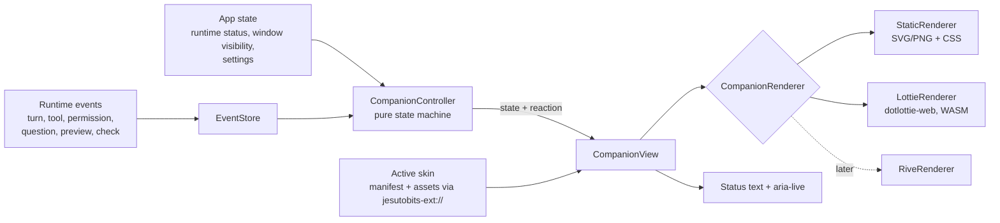

# Companion System

> Status: Agreed design. Renderer technology per ADR-0006 (provisional).

> **Reading this after ADR-0015 (Code-OSS fork):** "Host" is now the Jesutobits VS Code extension (`apps/vscode-extension/src`); "Workbench" is VS Code's window plus Jesutobits webviews (`apps/vscode-extension/webview`); Tauri IPC and capabilities are webview `postMessage` checked against `packages/protocol/src/webview.ts`; the OS credential store is VS Code SecretStorage; the "Node sidecar" is the runtime process on VS Code's Electron. Explorer, editor, terminal, Git, settings and colour themes are VS Code's. Sections are rewritten as their features are built on the fork.

## 1. Purpose and rules

The companion makes Jesutobits feel alive and shows, at a glance, what the agent is **actually** doing. It is optional, subtle by default, and never in the way.

Hard rules:

1. **Truthful:** the companion's state is computed from runtime events and app state only (FR-130). If nothing is running, it is idle. No random "busy" animations, no fake progress.
2. **Decoupled:** the runtime knows nothing about the companion. It emits generic events; the Workbench maps them.
3. **Unobtrusive:** the companion never covers the editor, the preview, approval cards or primary controls (FR-133).
4. **Accessible:** every state has a text equivalent; reduced motion is respected (FR-132, FR-136).
5. **Safe:** skins are data. They cannot run code, read files or make network requests (ADR-0007).

## 2. Architecture



`CompanionController` is a pure function plus timers: `(events, appState, now) → { state, reaction? }`. It has no rendering code and is unit-tested exhaustively.

## 3. State model

### 3.1 States

| State | Meaning | Derived from (all must be true) | Kind |
|---|---|---|---|
| `idle` | Nothing is happening | Runtime ready, no active turn, no pending approval or question | resting |
| `thinking` | A model request is in flight | Active turn in `understanding`, `thinking`, `responding` or `compacting` | active |
| `planning` | The agent is updating its plan | An `update_plan` tool call is executing | active |
| `reading` | Reading or searching files | Running tool with category `reading` | active |
| `editing` | Changing files | Running tool with category `editing` | active |
| `running` | Running commands, installing, Git | Running tool with category `running`, `installing` or `git` | active |
| `testing` | Running checks or preview checks | Running tool with category `testing`, or `check.started` without `check.completed` | active |
| `waiting_permission` | Waiting for the user to approve | A `permission.requested` without `permission.resolved` | blocking |
| `asking` | Waiting for the user to answer | A `question.asked` without `question.answered` | blocking |
| `paused` | User paused the turn | Turn state `paused` | blocking |
| `error` | Something failed and needs attention | `turn.failed`, preview `crashed`, or runtime `failed`; cleared when the user opens it, starts a new turn, or after 20 s | sticky |
| `completed` | Turn finished | `turn.completed` within the last 4 s | transient |
| `cancelled` | Turn was cancelled | `turn.cancelled` within the last 2 s | transient |
| `preview_ready` | Preview just became ready | `preview.status_changed → ready` within the last 2.5 s | transient |
| `unavailable` | Runtime is restarting or down | Runtime status `restarting` or `failed` | resting |

### 3.2 Reactions (one-shot, never states)

Reactions are short overlays played on top of the current state, only at Standard or Expressive levels: `check_passed`, `tool_failed`, `approval_granted`, `greeting` (app start). A reaction never implies ongoing work.

### 3.3 Priority

When several conditions hold, the highest wins:

```
waiting_permission > asking > error > paused > unavailable
  > testing > editing > running > reading > planning > thinking
  > completed > cancelled > preview_ready > idle
```

### 3.4 Timing rules

- **Minimum dwell 400 ms** between two *active* states, so very fast tool calls do not cause flicker. Dwell never extends an active state after the turn has ended: on `turn.completed`, `turn.failed` or `turn.cancelled` the controller switches immediately.
- Event bursts within 150 ms are coalesced.
- Transient states expire on the timers in 3.1 and fall back to the next applicable state (usually `idle`).
- The companion reflects the same state as the timeline and status bar within 250 ms (J-07).

### 3.5 Mapping examples

| Event sequence | Companion |
|---|---|
| `turn.started` → `turn.state_changed(thinking)` | `thinking` |
| `tool.started(read_file)` 80 ms → `tool.completed` → `tool.started(edit_file)` | `reading` (held 400 ms) → `editing` |
| `permission.requested` | `waiting_permission` (highest priority) |
| `turn.completed` | `completed` for 4 s → `idle` |
| No events for 10 minutes, no turn | `idle` the whole time |

## 4. Renderer interface

```ts
// apps/desktop/src/features/companion/renderer.ts
export interface CompanionRenderer {
  readonly kind: "static" | "lottie" | "rive";
  mount(container: HTMLElement, skin: ResolvedCompanionSkin, opts: RenderOptions): Promise<void>;
  setState(state: CompanionState, info: { from: CompanionState }): void;
  playReaction(reaction: CompanionReaction): void;
  setExpressiveness(level: "minimal" | "standard" | "expressive"): void;
  setReducedMotion(enabled: boolean): void;
  pause(): void;      // window hidden, companion collapsed
  resume(): void;
  destroy(): void;    // frees canvas, WASM instance, timers
}

export interface RenderOptions {
  sizePx: number;
  devicePixelRatioCap: 2;
  maxFps: 30;
}
```

- **StaticRenderer:** swaps an image or inline-sanitised SVG per state; CSS transitions (opacity, small scale) only. Used for Minimal level, reduced motion, and as fallback.
- **LottieRenderer:** `@lottiefiles/dotlottie-web` with the WASM file shipped in Jesutobits (not fetched from a CDN, RN-30). A skin's clips are either **markers** in one `.lottie` animation or separate animations inside a `.lottie` bundle. Looping clips loop; one-shot clips return to the state's loop clip. Cross-fade of 150 ms between clips when the skin does not provide a transition clip. The dotLottie state machine API is not used (ADR-0006).
- **RiveRenderer (later):** maps each Jesutobits state to a Rive state machine input (`boolean`, `trigger` or `number`) declared in the skin manifest.

## 5. Skins

A companion skin is a Stage 1 extension (EXTENSION_SYSTEM.md section 5). It supplies:

- Assets: `.lottie` (preferred), `.svg` (sanitised: no scripts, no external references, no `foreignObject`), `.png` or `.webp` posters.
- A **state map**: for each state, a clip and loop flag.
- Optional reaction clips and optional sounds.
- Display metadata: name, author, preview image, supported sizes, tone (`subtle`, `playful`, `energetic`, `minimal`, `futuristic`, `character`).

### 5.1 Required states and fallbacks

To make skins easy to author, only six clips are required. Others fall back:

| State | Required? | Fallback |
|---|---|---|
| `idle` | Yes | |
| `thinking` | Yes | |
| `working` (virtual) | Yes | used by `reading`, `editing`, `running`, `testing` when they are not provided |
| `waiting` (virtual) | Yes | used by `waiting_permission`, `asking`, `paused` |
| `error` | Yes | |
| `completed` | Yes | also used by `preview_ready` |
| `planning` | No | `thinking` |
| `reading`, `editing`, `running`, `testing` | No | `working` |
| `waiting_permission`, `asking`, `paused` | No | `waiting` |
| `cancelled` | No | `idle` |
| `unavailable` | No | `idle` rendered at 50% opacity |

Every state also needs a **static poster** (a frame or image) for reduced motion. The validator derives it from the clip's first frame if not provided.

### 5.2 Built-in skins (MVP)

| Skin | Tone | Renderer | Notes |
|---|---|---|---|
| **Ember** (default) | subtle | lottie + static posters | Abstract glowing mark that brightens when thinking and pulses gently when working. Professional when static. |
| **Dot** | minimal | static | A single status dot with colour per state. Used at Minimal level. |
| **Pip** | playful | lottie | Small character, shows that character skins work end to end. |

## 6. Configuration (user settings)

| Setting | Values | Default |
|---|---|---|
| Companion | On, Off | On |
| Expressiveness | Minimal, Standard, Expressive | Standard (with the subtle Ember skin), or the user's onboarding choice |
| Placement | Agent panel header, Status bar, Floating (corners of the agent panel or preview gutter only) | Agent panel header |
| Size | Small 24 px, Medium 48 px, Large 96 px (Large only in agent panel header) | Small |
| Idle behaviours (blinks, small idle loops in the skin) | On, Off | Off; only allowed at Expressive and never resemble work states |
| Reactions | On, Off | On at Standard and above |
| Sounds | On, Off, volume | **Off** (FR-135) |
| Announcements | Off, Important only (permission, question, error, completed), All | Important only |

Floating placement uses `pointer-events: none` except on its own drag handle, snaps to allowed zones, and never renders above dialogs, approval cards, the editor text area or the preview iframe.

## 7. Accessibility and reduced motion

- If the OS `prefers-reduced-motion: reduce` is set, or the app's "Reduce motion" setting is on, renderers show the static poster for each state and skip reactions (FR-132).
- A visually hidden status text mirrors the state ("Agent is editing files"). An `aria-live="polite"` region announces important states according to the Announcements setting.
- Colour is never the only signal: the status bar text and timeline carry the same information.
- Companion focus: it is not in the tab order unless it has an action (clicking it opens the timeline at the current activity).

## 8. Performance

- The renderer is lazy-loaded; with the companion Off, no animation code or WASM is loaded.
- Frame rate capped at 30 fps, canvas sized to the element with a DPR cap of 2.
- Paused when the window is hidden or minimised, or when the companion is collapsed (NFR-023).
- If average frame time exceeds 8 ms over 5 s, the controller switches to the static renderer and shows a one-time notice.

## 9. Fallbacks and errors

| Problem | Behaviour |
|---|---|
| Skin asset fails to load or decode | Use that state's static poster; if missing, use the built-in Dot skin; log a warning visible in the Extensions page |
| Skin missing a required state at load time | Should be impossible after validation; treated as above |
| WASM fails to initialise | StaticRenderer for all skins until restart |
| Unknown renderer in an installed skin (from a newer Jesutobits) | Skin marked incompatible (FR-146), default skin used |

## 10. Testing

- **Controller unit tests:** table-driven event sequences → expected state timelines, including dwell and expiry with a fake clock.
- **Truthfulness property test:** generate random valid event sequences; assert that whenever the companion is in an *active* state, there is an in-flight model request or running tool in the event history at that instant (± dwell, never after a terminal turn event).
- **Renderer tests:** StaticRenderer snapshots per state; LottieRenderer smoke test with the built-in skin in Playwright (frames advance, pause on hidden).
- **Accessibility tests:** reduced-motion emulation shows posters; announcements fire for the right states.
