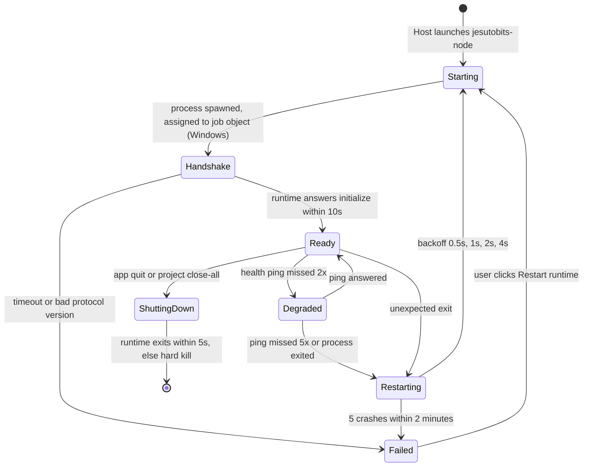

# ADR-0002: Agent runtime as a managed Node.js sidecar

- **Status:** Accepted; amended by ADR-0015 (see its Consequences)
- **Date:** 2026-10-19
- **Related:** ADR-0001, ADR-0003, ADR-0011, RN-01, RN-02, RN-03, RN-11, RN-12, RN-14, RN-17

## Context

The agent runtime (model calls, agent loop, tools, permissions, previews, sessions) is written in TypeScript and needs Node.js APIs: child processes, file system, HTTP streaming, SQLite. Tauri does not provide Node. End users must not need to install Node just to run Jesutobits.

Packaging options for Node code:

- **Node SEA**: official, but Stability 1.1, native addons need temp-file extraction, macOS x64 untested in Node CI (RN-11).
- **pkg**: used by the Tauri guide, but `vercel/pkg` is archived; `@yao-pkg/pkg` is the maintained fork (RN-12).
- **Ship the official Node binary unchanged** as the sidecar and run our bundled JavaScript with it.

## Decision

1. Ship the **official Node.js binary** (Node 26 LTS line, at least 26.6 to include the fixes in RN-13) as a Tauri sidecar named `jesutobits-node` via `bundle.externalBin`, with target-triple suffixes (RN-02).
2. Bundle the runtime into a single ESM file (`runtime/main.mjs`) plus static assets with Rolldown or esbuild, shipped as Tauri **resources**.
3. The runtime has **no native addons** in the MVP. SQLite uses `node:sqlite` (ADR-0008). PTYs live in the Host (ADR-0011). This keeps a later move to SEA open.
4. The Host starts the runtime as: `jesutobits-node --disable-warning=ExperimentalWarning <resources>/runtime/main.mjs --stdio` with a scrubbed environment and the app data directory passed as an argument.
5. The **Host owns the runtime lifecycle** (start, health, restart, shutdown). The Workbench never spawns processes.

### Lifecycle

Shutdown order: Host sends `runtime.shutdown` → runtime cancels the active agent turn, stops managed processes, flushes SQLite, exits with code 0. If the runtime has not exited in 5 seconds, the Host kills it. On Windows the job object then kills every descendant (ADR-0011).

Parent-death detection: the runtime treats **EOF on stdin** as "the Host is gone" and performs the same shutdown. This covers Host crashes on all platforms.

## Alternatives considered

| Option | Why not |
|---|---|
| Node SEA single binary | Promising, but still in active development and awkward with native addons. Revisit at Phase 7. |
| `@yao-pkg/pkg` | Third-party patched Node builds add a supply-chain dependency and lag Node security releases. |
| Require users to install Node | Hostile to beginners (a core user group). We still detect a system Node for *user projects* (see ADR-0011), but Jesutobits itself must run without it. |
| Bun or Deno compile | Smaller binaries, but different runtime semantics for child processes and SQLite, and our dependencies target Node. |
| Run the runtime inside the webview | No file system or process access, and it would put privileged code in the same context as rendered model output. |

## Trade-offs

- **Size**: the Node binary adds roughly 80 to 120 MB uncompressed per platform. Accepted. NFR-005 sets the installer budget.
- **Updates**: Node security releases require a Jesutobits release. The updater must be able to ship runtime-only updates later.
- **Signing**: on macOS the Node binary must be signed with our identity as part of the app bundle. On Windows an unsigned sidecar inside a signed installer still triggers SmartScreen reputation issues, so we sign it too.

## Consequences

- The runtime must start fast (NFR-002): no heavy work before answering `initialize`.
- A build script fetches the pinned Node binary per target, verifies its SHA-256 against the official `SHASUMS256.txt`, renames it with the target triple, and places it in `apps/desktop/src-tauri/binaries/`.
- Native dependencies are banned from `packages/runtime` by a lint rule unless an ADR allows one.
- Standalone helper executables are allowed as additional sidecars because they do not affect the Node packaging choice. The MVP ships one: ripgrep as `jesutobits-rg`, used by the `search_text` tool, with a pure JavaScript fallback if it is missing.
- Spike S1 (2026-10-20, `docs/spikes/S1.md`) implemented points 1 to 5 as written. The bundle is built to `packages/runtime/dist/bundle/runtime.mjs` and mapped to the `runtime/main.mjs` resource in `tauri.conf.json`. The Host spawns the sidecar itself with `tokio::process` (not the Tauri shell plugin, so the webview gets no shell capability; NFR-008), with the ADR-0011 environment allowlist and `--data-dir`. Auto-restart with backoff is Phase 1 work; S1 ends in `failed` on an unexpected exit.
- Auto-restart landed in Phase 1 (`runtime_supervisor/`, tests in `runtime_supervisor/tests.rs` against `fixtures/bin/fake-runtime.mjs`). Three clarifications of the diagram:
  - **What counts as a crash.** A process that exits without being asked, before or after the handshake, or that misses 5 health pings, is a crash and goes through Restarting. A handshake timeout, a protocol mismatch and a failed spawn or job assignment go straight to Failed, because retrying cannot fix them.
  - **Backoff.** The wait grows with the number of crashes inside the two-minute window: 0.5, 1, 2, then 4 s. The diagram used to list 8 s as a fifth step, but the fifth crash within two minutes already ends in Failed, so that step could never be reached; it was dropped.
  - **The end of stdout is the signal.** On a busy Windows machine the exit of a process can be reported a second or more after its stdout closes. The supervisor treats stdout ending as the runtime ending (a crash, or the shutdown it asked for) and waits up to 5 s for the exit before killing it, instead of pinging a dead pipe and showing Degraded.
  - **Restart from Failed** is the `runtime_restart` command (`HostBridge.restartRuntime()`). It forgets the crash history and is ignored in every other state.
- The Node Permission Model (RN-17) is evaluated in Phase 7 as defence in depth. It is not a sandbox for user code, because commands the agent runs are separate processes.

## Revisit when

- Node SEA reaches Stability 2 with VFS module loading, or
- installer size becomes a measurable adoption problem, or
- a required capability can only be met by a native addon.
