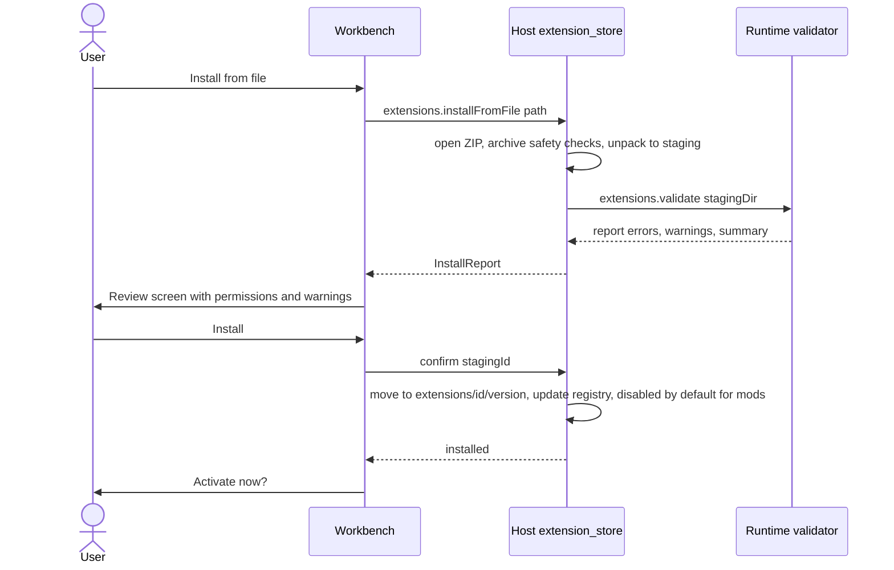

# Extension System: Themes, Companion Skins and Mods

> Status: Stage 1 is MVP and agreed. Stages 2 and 3 are designed at sketch level so Stage 1 choices do not block them (ADR-0007).

## 1. Overview

Customisation is a core part of Jesutobits' identity. It is built as an ecosystem of installable packages rather than a settings page.

| Category | What it changes | Code? | Permissions | Stage |
|---|---|---|---|---|
| **Theme** | Colours, typography, radii, density, shadows, editor and terminal colours, preview chrome, focus and selection states, optional subtle background | No | None allowed | 1 (MVP) |
| **Companion skin** | Companion appearance, state-to-clip mapping, reactions, optional sounds, sizes | No | None allowed | 1 (MVP) |
| **Layout preset** | Panel arrangements (contributed by any Stage 1 package or saved by the user) | No | None allowed | 1 (MVP) |
| **Mod: UI** | Panels, status items, activity visualisations, preview inspector sections, palette commands | Yes, sandboxed | Declared and granted | 2 (later) |
| **Mod: Integration** | Agent tools and external services via MCP servers | Yes, separate process | Declared and granted; every tool call goes through the permission broker | 3 (later) |

A single package has exactly one `kind`: `theme`, `companion-skin` or `mod`. A theme package may contribute several theme variants (for example light and dark), and a companion package may contribute several skins.

## 2. Why staged

Summarised from ADR-0007: Stage 1 delivers most of the personality value with almost no attack surface; staging lets the APIs for code-running mods be designed from real demand; each stage's isolation mechanism (parse-only data, sandboxed iframe, separate process) can be tested on its own; and unrestricted in-app JavaScript would let any mod steal credentials or approve actions.

## 3. Package format and manifest

### 3.1 Package layout

A package is a ZIP archive with the extension `.jesutobitspkg`, or an unpacked folder in developer mode:

```
midnight-ink-1.2.0.jesutobitspkg
├── jesutobits-extension.json        # manifest (required, at root)
├── README.md                  # shown on the detail page (rendered as sanitised Markdown)
├── LICENSE
├── assets/
│   ├── icon.png               # 128x128
│   └── preview-dark.png
└── themes/
    ├── midnight-ink.dark.json
    └── midnight-ink.light.json
```

Only files referenced by the manifest (or `README.md`, `LICENSE`) are served by the Host. Everything else is ignored.

### 3.2 Manifest fields

| Field | Required | Rules |
|---|---|---|
| `$schema` | No | Path to the JSON Schema for editor autocomplete |
| `manifestVersion` | Yes | `1` |
| `id` | Yes | Lowercase, dot-separated, `[a-z0-9-]` segments, 3 to 100 chars, at least two segments (for example `dev.amara.midnight-ink`). Unique per installation. Never reused for a different extension |
| `name` | Yes | Display name, 1 to 60 chars |
| `version` | Yes | SemVer 2.0 |
| `kind` | Yes | `theme`, `companion-skin`, `mod` |
| `description` | Yes | 1 to 300 chars |
| `author` | Yes | `{ name, url?, email? }`. Shown as **unverified** in the MVP |
| `license` | Yes | SPDX identifier |
| `homepage`, `repository` | No | URLs, shown as text with an "Open in browser" action |
| `icon` | No | Path to PNG or WebP, 128×128 |
| `engines.jesutobits` | Yes | SemVer range of compatible Jesutobits versions |
| `capabilities` | Yes | What the package **provides**: subset of `theme`, `companion`, `layout-preset`, `ui-panel`, `status-item`, `activity-renderer`, `preview-inspector`, `command`, `tool-provider`. Must match `contributes` |
| `contributes` | Yes | Contribution objects keyed by type (see sections 4, 5, 10) |
| `permissions` | Yes | What the package **needs** (section 6). Must be `[]` for `theme` and `companion-skin` |
| `dependencies` | No | `{ "<extension-id>": "<semver range>" }`. Stage 1 uses this only for `extends` between themes |
| `compatibility.platforms` | No | `["windows", "macos", "linux"]`, default all |

### 3.3 Schema sketch

```ts
// packages/extension-schema/src/manifest.ts (sketch)
export const ExtensionId = z.string().regex(/^[a-z0-9-]+(\.[a-z0-9-]+)+$/).min(3).max(100);

export const ManifestV1 = z.object({
  $schema: z.string().optional(),
  manifestVersion: z.literal(1),
  id: ExtensionId,
  name: z.string().min(1).max(60),
  version: SemVer,
  kind: z.enum(["theme", "companion-skin", "mod"]),
  description: z.string().min(1).max(300),
  author: z.object({ name: z.string().min(1), url: z.string().url().optional(), email: z.string().email().optional() }),
  license: SpdxId,
  homepage: z.string().url().optional(),
  repository: z.string().url().optional(),
  icon: PackagePath.optional(),
  engines: z.object({ jesutobits: SemVerRange }),
  capabilities: z.array(Capability).min(1),
  contributes: Contributions,
  permissions: z.array(Permission),
  dependencies: z.record(ExtensionId, SemVerRange).optional(),
  compatibility: z.object({ platforms: z.array(z.enum(["windows", "macos", "linux"])) }).optional(),
}).superRefine(checkKindConsistency); // kind ↔ capabilities ↔ contributes ↔ permissions
```

`PackagePath` rejects absolute paths, `..` segments, backslashes, drive letters, NUL and paths over 200 chars.

## 4. Themes

### 4.1 Design tokens

Themes are **token files**, not CSS. The Workbench's `ThemeEngine` compiles tokens into CSS custom properties (`--jesutobits-color-canvas`), a Monaco theme (`monaco.editor.defineTheme`) and an xterm.js theme. Workbench components only use tokens (a lint rule forbids raw colour literals in components), so a theme can restyle the whole UI without CSS overrides.

| Group | Tokens | Notes |
|---|---|---|
| Base | `base` | `light`, `dark` or `high-contrast`. Missing optional tokens are filled from the built-in theme of that base |
| Surfaces | `color.canvas`, `color.surface`, `color.surface.raised`, `color.surface.sunken` | App background, panels, popovers, inputs |
| Text | `color.text`, `color.text.muted`, `color.text.subtle`, `color.text.onAccent` | |
| Borders | `color.border`, `color.border.strong`, `border.width` (1 or 2 px) | |
| Accent | `color.accent`, `color.accent.hover`, `color.accent.subtle` | Buttons, links, active tabs |
| States | `color.focus`, `color.selection`, `color.item.hover`, `color.item.active` | Focus ring, selection, list hover and active |
| Status | `color.success`, `color.warning`, `color.danger`, `color.info` and `.subtle` variants | |
| Diff | `color.diff.added`, `color.diff.removed` | |
| Preview chrome | `color.preview.chrome`, `color.preview.inspect`, `color.preview.draft` | Toolbar, inspect outline, draft outline |
| Editor | `editor.background`, `editor.foreground`, `editor.lineHighlight`, `editor.selection`, `editor.cursor`, `editor.gutter` | |
| Syntax | `syntax.keyword`, `syntax.string`, `syntax.number`, `syntax.comment`, `syntax.function`, `syntax.type`, `syntax.variable`, `syntax.punctuation` | Mapped to Monaco token rules |
| Terminal | `terminal.background`, `terminal.foreground`, `terminal.ansi.<16 colours>` | Optional; derived from base if absent |
| Typography | `font.ui`, `font.mono` (family stacks; may reference bundled fonts), `font.size.base` (12 to 16 px), `lineHeight.base` (1.3 to 1.7) | |
| Shape | `radius.sm`, `radius.md`, `radius.lg` (0 to 16 px) | |
| Density | `density` (`compact`, `comfortable`), `space.scale` (0.85 to 1.15) | Bounded so layouts cannot break |
| Elevation | `shadow.sm`, `shadow.md`, `shadow.lg` | Validated `box-shadow` syntax, no `url()` |
| Motion | `motion.scale` (0 to 1.5; 0 disables UI transitions) | OS reduced motion always wins |
| Background | `background.image` (package path), `background.mode` (`cover`, `tile`), `background.opacity` (0 to 0.15) | Applied behind the canvas only, never behind editor text |

### 4.2 Example token file

```json
{
  "tokenFormat": 1,
  "base": "dark",
  "color.canvas": "#0d1117",
  "color.surface": "#131a24",
  "color.surface.raised": "#1a2330",
  "color.surface.sunken": "#0a0e14",
  "color.text": "#e6edf3",
  "color.text.muted": "#9aa7b4",
  "color.border": "#263241",
  "color.accent": "oklch(0.72 0.15 250)",
  "color.accent.hover": "oklch(0.78 0.15 250)",
  "color.focus": "#7cc4ff",
  "color.preview.inspect": "#4ea1ff",
  "color.preview.draft": "#f5a524",
  "editor.background": "#0d1117",
  "syntax.keyword": "#ff7b72",
  "syntax.string": "#a5d6ff",
  "font.ui": "Inter, system-ui, sans-serif",
  "font.mono": "JetBrains Mono, Consolas, monospace",
  "radius.md": "8px",
  "density": "comfortable"
}
```

### 4.3 Built-in themes

`Jesutobits Light`, `Jesutobits Dark` (default follows the OS), `Jesutobits High Contrast`. They are packaged exactly like third-party themes (read-only, in the app's resources) so the token pipeline is always exercised.

## 5. Companion skins

Contribution format (renderer and state rules in COMPANION_SYSTEM.md sections 4 and 5):

```jsonc
"contributes": {
  "companions": [
    {
      "id": "pip",
      "label": "Pip",
      "tone": "playful",
      "renderer": "lottie",                       // "static" | "lottie" ("rive" reserved)
      "source": "companions/pip.lottie",           // single bundle with markers
      "sizes": ["small", "medium", "large"],
      "states": {
        "idle":      { "clip": "idle",      "loop": true },
        "thinking":  { "clip": "think",     "loop": true },
        "working":   { "clip": "busy",      "loop": true },
        "waiting":   { "clip": "wait",      "loop": true },
        "error":     { "clip": "oops",      "loop": false },
        "completed": { "clip": "yay",       "loop": false },
        "editing":   { "clip": "type",      "loop": true }
      },
      "reactions": { "check_passed": { "clip": "thumbs" } },
      "posters": { "idle": "companions/posters/idle.png" },
      "idleBehaviours": { "clip": "blink", "minIntervalMs": 8000 },
      "sounds": { "completed": "companions/sounds/chime.ogg" }
    }
  ]
}
```

Rules: `states` must contain the six required keys (`idle`, `thinking`, `working`, `waiting`, `error`, `completed`); other keys must be known state names; clips must exist as markers or animation IDs in `source`; posters are generated from first frames when missing.

## 6. Permissions

### 6.1 Catalogue

| Permission | Stage | Risk | Grants |
|---|---|---|---|
| *(none)* | 1 | none | Themes, companion skins and layout presets request nothing and get nothing beyond having their declared assets served |
| `ui.panel`, `ui.statusItem`, `ui.activityRenderer`, `ui.previewInspector` | 2 | low | Render inside a sandboxed iframe in the named surface |
| `commands.register` | 2 | low | Add command palette entries that send a message to the extension |
| `notifications.show` | 2 | low | Show toasts (rate-limited) |
| `storage.private` | 2 | low | 5 MB key-value store private to the extension |
| `agent.events.read` | 2 | medium | Redacted runtime events for the active project (no file contents, no tool outputs, no chat text) |
| `preview.selection.read` | 2 | medium | The current element selection payload |
| `project.metadata.read` | 2 | medium | Project name, framework detection, file **paths** (no contents) |
| `chat.insertDraft` | 2 | medium | Put text into the chat box; the user must press Send |
| `project.files.read` | 3 | high | Read file contents in the active project through the runtime |
| `agent.tools.provide` | 3 | high | Offer MCP tools to the agent; each call goes through the permission broker with risk class `external` |
| `process.spawn` | 3 | high | Start the extension's own declared MCP server process |
| `network:<host>` | 3 | high | Declared outbound host for the extension's server (enforcement design open, section 10.2) |
| `secrets.own` | 3 | high | Store the extension's own credentials in the OS store under its namespace |

### 6.2 Never grantable

No permission exists for: Jesutobits' provider credentials, other extensions' storage or secrets, the Workbench DOM, Tauri IPC, typing into terminals, approving permission requests, files outside the active project, or changing Jesutobits' permission policy.

### 6.3 Enforcement

| Boundary | Mechanism |
|---|---|
| Stage 1 content | Parsed as data (JSON, sanitised SVG, images, `.lottie` without expressions, WOFF2). No code path executes extension content |
| File serving | Host `jesutobits-ext://` handler serves only manifest-referenced files from the extension's own folder, with `Content-Security-Policy: default-src 'none'` for data files |
| Stage 2 UI | `sandbox="allow-scripts"` iframe (opaque origin, no same-origin access), strict CSP with `connect-src 'none'`, no Tauri IPC (RN-06). All capabilities via a postMessage RPC to the Workbench's `ExtensionBroker`, which checks granted permissions per call, validates payloads, and rate-limits |
| Stage 3 processes | Started by the runtime only after the user grants `process.spawn`; tools are proxied through the permission broker; outputs are labelled untrusted in model context |

## 7. Validation

Validation runs in the runtime (`extensions.validate`, using `packages/extension-schema`), after the Host's archive checks. The same validator powers `jesutobits-ext validate` in the CLI.

| Check | Rule | Severity |
|---|---|---|
| Archive | ZIP only; ≤ 25 MB compressed, ≤ 60 MB uncompressed, ≤ 2,000 entries; no symlinks; safe paths (3.3) | Error |
| Manifest | ≤ 64 KB; schema-valid; kind, capabilities, contributes and permissions consistent | Error |
| Compatibility | `engines.jesutobits` satisfied by the running version; `manifestVersion` known | Error |
| Permissions | Allowed for the kind and for the stages this Jesutobits version supports; Stage 2/3 permissions on an MVP build give "Requires a newer Jesutobits" | Error |
| References | Every path in the manifest exists inside the package | Error |
| Theme tokens | ≤ 256 KB; known token names; colours parse (hex, `rgb()`, `hsl()`, `oklch()`); numeric ranges (4.1) | Error |
| Theme contrast | `color.text` on `color.canvas` and `color.surface` ≥ 4.5:1 → else warning; < 3:1 → error | Warning / Error |
| Fonts | WOFF2 only, ≤ 2 MB each, ≤ 4 files | Error |
| Images | PNG, WebP, JPEG; ≤ 2 MB; ≤ 4096 px per side; decoded successfully | Error |
| SVG | Parsed as XML; reject `script`, `foreignObject`, event-handler attributes, external `href`/`xlink:href`, `url()` to external resources. The Workbench additionally sanitises with DOMPurify's SVG profile at load time | Error |
| `.lottie` | ≤ 5 MB each, ≤ 15 MB total; ≤ 1024×1024; frame rate ≤ 60; no external asset URLs; **no expressions** (rejected rather than relying on renderer behaviour, RN-31); required clips present | Error |
| Sounds | OGG, MP3 or WAV; ≤ 300 KB; ≤ 3 s | Error |
| README | ≤ 100 KB; rendered with the same sanitised Markdown renderer as chat | Error if larger |

Errors block installation and list file, field and reason. Warnings are shown and installation can continue.

## 8. Lifecycle

### 8.1 Browse installed extensions

Settings > Extensions shows tabs for Themes, Companions, Layouts and (later) Mods. Each card: icon, name, version, author (unverified), kind, status (Active, Enabled, Disabled, Incompatible, Error), permissions summary, size.

### 8.2 Preview

- Themes: "Preview" applies the theme to a mock workbench inside the settings page (and optionally to the whole UI for 30 seconds with a Keep / Revert bar).
- Companions: a state stepper plays each state, reaction and poster at each size; reduced-motion preview included.

### 8.3 Install



Developer mode adds "Load unpacked folder": the folder is validated in place, watched for changes, and re-validated and reloaded on every change (FR-142).

### 8.4 Compatibility and updates

- Installing a **higher version** of an installed ID is an update. The review screen shows a permission diff; new permissions are highlighted and must be accepted. The previous version folder is kept until the new one loads successfully, then deleted (automatic rollback on load failure).
- Installing a **lower version** asks for confirmation (downgrade).
- After Jesutobits upgrades, every installed extension's `engines.jesutobits` is re-checked at startup. Incompatible ones are disabled with a notice and the default theme or companion takes over (FR-146).
- **Dependencies:** missing or out-of-range dependencies leave the package installed but disabled with "Requires <name> <range>". Themes may `extends` another installed theme; cycles are rejected.
- **Conflicts:** only one theme and one companion skin are active at a time, so contributions never clash. Contribution IDs are namespaced by extension ID internally (`dev.amara.midnight-ink/dark`).

### 8.5 Enable, disable, switch

- For themes and companions, *enabled* means "available in pickers"; *active* means "in use". Disabling the active one switches to the built-in default immediately (J-13).
- Switching themes or skins applies within 200 ms without restart (J-11).

### 8.6 Uninstall

Removes the package folders and registry entry after confirmation. For later stages it also removes the extension's private storage and its OS-store secrets.

### 8.7 Recovery from incompatible or broken extensions

- The Host writes an "extensions loading" marker before the Workbench applies the active theme and skin, and clears it once the Workbench reports a successful first render. Two consecutive starts with the marker still set trigger **Safe mode** (FR-147).
- A theme that fails at runtime (for example a font fails to load) falls back per token to the base theme and shows a notice on the Extensions page.
- Safe mode shows a banner with "Re-enable extensions one at a time".

### 8.8 Inspect permissions

Each extension's detail page lists its permissions in plain language with a risk badge, the data it can see, and (Stage 2 and later) a toggle to revoke each one. Revoked calls fail with `permission_denied` inside the extension.

## 9. Developer experience

- **`@jesutobits/extension-cli`** (binary `jesutobits-ext`, published from `packages/extension-cli`):
  - `jesutobits-ext init theme|companion` scaffolds a package with a valid manifest and sample assets.
  - `jesutobits-ext validate [dir]` runs the same validator as Jesutobits and prints errors with file and field.
  - `jesutobits-ext pack [dir]` produces a `.jesutobitspkg` after validation.
- **JSON Schema** for the manifest and token files ships in the CLI package for editor autocomplete via `$schema`.
- **Developer mode** in Jesutobits: load unpacked, live reload, a token inspector that shows which token styles the element under the cursor, and "Export current theme as package".
- **Documentation**: this file plus an authoring guide (to be written in Phase 6) with a theme tutorial and a companion skin tutorial (After Effects/Lottie Creator markers to Jesutobits states).
- Packages are **unsigned** in the MVP. The UI labels authors as unverified. Signing arrives with a repository (section 11).

## 10. Later stages (design sketches)

### 10.1 Stage 2: sandboxed UI mods

```jsonc
"contributes": {
  "panels": [{ "id": "focus-timer", "title": "Focus Timer", "entry": "ui/panel.html", "icon": "assets/timer.svg", "defaultDock": "right" }],
  "statusItems": [{ "id": "timer", "entry": "ui/status.html", "minWidth": 80 }],
  "commands": [{ "id": "start-focus", "title": "Start focus session" }],
  "activityRenderers": [{ "id": "tests-chart", "eventTypes": ["check.completed"], "entry": "ui/tests.html" }]
}
```

- Each entry loads in `<iframe sandbox="allow-scripts">` from `jesutobits-ext://<id>/...` with CSP `default-src 'none'; script-src 'self'; style-src 'self' 'unsafe-inline'; img-src 'self' data:; font-src 'self'; connect-src 'none'; frame-src 'none'; form-action 'none'`.
- `@jesutobits/extension-api` gives a typed client: `jesutobits.events.subscribe(filter)`, `jesutobits.storage.get/set`, `jesutobits.ui.notify`, `jesutobits.chat.insertDraft`, `jesutobits.theme.tokens()` (so mods match the active theme), `jesutobits.commands.onInvoke`.
- The `ExtensionBroker` checks permission per call, caps payload sizes (256 KB) and call rates (50/s), and kills an iframe that exceeds limits repeatedly.

### 10.2 Stage 3: integrations via MCP

```jsonc
"contributes": {
  "toolProviders": [{
    "id": "issues",
    "transport": "stdio",
    "command": ["node", "server/index.js"],
    "toolRiskHints": { "create_issue": ["network", "external"] }
  }]
}
```

- JavaScript servers run on Jesutobits' bundled Node under the Node Permission Model (RN-17): read access to the extension folder only, plus the project if `project.files.read` is granted, no child processes. This restricts file system access but **not network access**; network enforcement needs OS-level sandboxing and is an open design item.
- Tools appear to the agent as `ext.<extensionId>.<tool>` with risk class `external` plus the declared hints. Hints can only **raise** risk. Default policy: ask.
- MCP revision targeted: 2026-07-28 (RN-34).

## 11. Future repository or marketplace

Not part of the MVP. When added:

- A static, Git-hosted index of packages with signed releases (signature verified by the Host before install).
- Review for Stage 2 and 3 packages; automated validation for all.
- Permission-based badges ("No permissions", "Reads your project").
- Opt-in update checks; no automatic background downloads.

## 12. Complete manifest examples

### 12.1 Theme

```json
{
  "$schema": "./node_modules/@jesutobits/extension-cli/schema/manifest.v1.json",
  "manifestVersion": 1,
  "id": "dev.amara.midnight-ink",
  "name": "Midnight Ink",
  "version": "1.2.0",
  "kind": "theme",
  "description": "A calm, high-legibility dark theme with blue accents and a matching light variant.",
  "author": { "name": "Amara Obi", "url": "https://example.com/amara" },
  "license": "MIT",
  "icon": "assets/icon.png",
  "engines": { "jesutobits": ">=1.0.0 <2.0.0" },
  "capabilities": ["theme"],
  "contributes": {
    "themes": [
      { "id": "dark", "label": "Midnight Ink", "tokens": "themes/midnight-ink.dark.json", "preview": "assets/preview-dark.png" },
      { "id": "light", "label": "Midnight Ink Light", "tokens": "themes/midnight-ink.light.json" }
    ]
  },
  "permissions": []
}
```

### 12.2 Companion skin

```json
{
  "manifestVersion": 1,
  "id": "dev.tobi.pip-companion",
  "name": "Pip",
  "version": "0.3.1",
  "kind": "companion-skin",
  "description": "A tiny, cheerful companion that reacts to what your agent is doing.",
  "author": { "name": "Tobi" },
  "license": "CC-BY-4.0",
  "icon": "assets/icon.png",
  "engines": { "jesutobits": ">=1.0.0 <2.0.0" },
  "capabilities": ["companion"],
  "contributes": {
    "companions": [
      {
        "id": "pip",
        "label": "Pip",
        "tone": "playful",
        "renderer": "lottie",
        "source": "companions/pip.lottie",
        "sizes": ["small", "medium", "large"],
        "states": {
          "idle": { "clip": "idle", "loop": true },
          "thinking": { "clip": "think", "loop": true },
          "working": { "clip": "busy", "loop": true },
          "waiting": { "clip": "wait", "loop": true },
          "error": { "clip": "oops", "loop": false },
          "completed": { "clip": "yay", "loop": false }
        },
        "reactions": { "check_passed": { "clip": "thumbs" } }
      }
    ]
  },
  "permissions": []
}
```

### 12.3 Functional mod (Stage 2, not loadable by the MVP)

```json
{
  "manifestVersion": 1,
  "id": "dev.kemi.test-pulse",
  "name": "Test Pulse",
  "version": "0.1.0",
  "kind": "mod",
  "description": "Shows a live chart of test results from agent checks in a side panel.",
  "author": { "name": "Kemi" },
  "license": "Apache-2.0",
  "engines": { "jesutobits": ">=1.1.0 <2.0.0" },
  "capabilities": ["ui-panel", "activity-renderer"],
  "contributes": {
    "panels": [
      { "id": "pulse", "title": "Test Pulse", "entry": "ui/panel.html", "icon": "assets/pulse.svg", "defaultDock": "right" }
    ],
    "activityRenderers": [
      { "id": "check-row", "eventTypes": ["check.completed"], "entry": "ui/check-row.html" }
    ]
  },
  "permissions": ["ui.panel", "ui.activityRenderer", "agent.events.read", "storage.private"]
}
```

An MVP build rejects this package with "Mods require Jesutobits 1.1 or newer" because `engines.jesutobits` is not satisfied and Stage 2 permissions are reserved.
