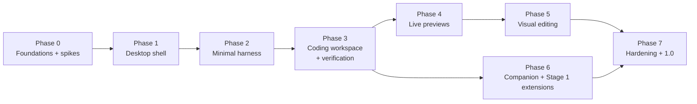

# Roadmap

> Status: Agreed plan. Durations are rough planning ranges for one to two developers working with coding agents, not commitments.
> Version scheme: phases ship internal builds `0.<phase>`; the MVP release is **1.0** after Phase 7.

## 1. Changes from the suggested sequence

The suggested phase order is kept, with four adjustments driven by risk:

1. **Spikes move into Phase 0.** The riskiest assumptions (Node sidecar lifecycle on Windows, Vite instrumentation, localhost iframes in OS webviews) are tested before anything depends on them.
2. **Theme tokens move into Phase 1.** Every Workbench component uses tokens from the first line of UI code. Retrofitting tokens later is expensive. Only *installing* themes waits for Phase 6.
3. **Verification moves into Phase 3** with commands, because "do not claim it works" must be true from the first time the agent can run anything.
4. **The runtime skeleton starts in Phase 1**, because the Workbench reads files through the runtime's WorkspaceService from day one (single writer).

Phase 6 depends on Phase 3 (runtime events exist), not on Phase 5, so it can run in parallel with Phases 4 and 5 if there are two people.

## 2. MVP versus later

| In MVP (1.0) | Later |
|---|---|
| Windows | macOS, Linux packages |
| OpenRouter | Direct Anthropic, OpenAI, Google; local models |
| Agent + Ask modes, project and general workspaces | Multiple windows, remote runtimes |
| File, search, command, process, check, preview, Git read + commit, visual tools | `fetch_url`, push/pull with approval, LSP integration |
| Generic + `vite-react` preview; visual editing for Tailwind and inline styles | Next.js, Expo, CSS Modules, usage-site prop edits, static sites |
| Companion: static + dotLottie renderers, 3 built-in skins | Rive renderer |
| Stage 1 extensions: themes, companion skins, layout presets; local install; CLI | Stage 2 UI mods, Stage 3 MCP integrations, repository/marketplace, signing |
| Tool-level checkpoints | Shadow-repo checkpoints, auto-commit to branch |
| Approval-based safety | OS-level command sandboxing |

## 3. Phases

### Phase 0: Foundations and spikes (2 to 3 weeks)

**Objectives:** prove the three riskiest assumptions; set up the repository, conventions and CI so later phases start fast.

**Included**
- Repository scaffold per PROJECT_STRUCTURE.md (empty packages with build, lint, test wired).
- `packages/protocol` with the envelope, error and first method schemas.
- CI on Windows and Ubuntu: lint, typecheck, unit tests, boundary rules.
- **Spike S1 (sidecar):** Tauri app spawns bundled Node running a stub runtime; JSON-RPC handshake over stdio; Host relay to a test page; Windows Job Object assignment; kill the Host from Task Manager and confirm no survivors; measure relay latency; open `node:sqlite` with WAL and write 10k events.
- **Spike S2 (visual edit feasibility):** in a plain browser, start a fixture Vite 8 + React 19 + Tailwind project through the launcher with an inline plugin (RN-24); instrument JSX; click an element and resolve its source; apply one Tailwind class change with `magic-string`; observe HMR.
- **Spike S3 (preview frame):** inside the Tauri Workbench on Windows (and WebKit in a Linux VM if available), load `http://127.0.0.1:<port>` in an iframe; postMessage both ways with origin checks; confirm no Tauri IPC from the frame.
- ADRs reviewed and statuses updated from spike results.

**Excluded:** any user-facing feature.

**Dependencies:** none.

**Deliverables:** scaffolded repo; spike reports in `docs/spikes/S1.md`, `S2.md`, `S3.md`; updated ADRs and RESEARCH_NOTES.

**Acceptance criteria**
- S1: handshake < 2 s; relay p95 < 5 ms for 1 KB messages; zero orphan processes in 10 forced-kill trials; 10k event inserts < 2 s.
- S2: selection resolves to the correct file:line:column for 20 sampled elements; class edit appears via HMR within 1 s; project `vite.config` untouched.
- S3: iframe loads and messages flow on Windows; IPC call attempt from the frame is rejected.
- CI green on both OSes.

**Tests:** spike scripts kept as integration tests where possible (S1 orphan test becomes a nightly desktop test).

**Risks:** S2 merge behaviour fails (fallback: wrapper config); S3 blocked by webview policy (fallback: proxy protocol).

**Definition of done:** spike reports written, ADR-0009 and ADR-0010 updated to Accepted or revised, CI green.

### Phase 1: Desktop shell (3 to 4 weeks) → 0.1

**Objectives:** a usable workbench that opens projects, edits files and looks like Jesutobits.

**Included**
- Host: runtime supervisor (from S1), settings store, folder dialog, window state.
- Runtime skeleton: `runtime.*`, `projects.*`, `fs.*` methods; WorkspaceService (confinement, atomic writes, watcher); projects table; migrations framework.
- Workbench: `HostBridge` + `MockHostBridge`; dock layout with presets and persistence; explorer; Monaco editor with tabs, save, external-change handling; quick open; status bar.
- ThemeEngine with token compiler; built-in Light, Dark, High Contrast as token packages.
- Start screen, recent projects, open folder, trust prompt (Restricted mode flag stored; enforcement arrives with tools).
- Onboarding skeleton: welcome, workspace folder, toolchain check, theme (provider steps stubbed).

**Excluded:** agent, terminal, previews, Git, companion visuals.

**Dependencies:** Phase 0.

**Deliverables:** Windows dev build; Playwright browser E2E for open/edit/save; desktop smoke test.

**Acceptance criteria**
- Cold start < 3 s on the reference machine (NFR-001).
- Open a 100k-file project without UI freeze (NFR-019).
- Editing and saving a file round-trips through WorkspaceService atomically; external change shows the "changed on disk" bar.
- Switching theme recolours UI and editor in < 200 ms.
- Layout changes persist per project across restarts.
- axe: no serious violations on start screen, workbench and settings.

**Tests:** unit (WorkspaceService, theme compiler, layout state), E2E (J-01 partial, J-03, J-05), desktop smoke.

**Risks:** Monaco worker setup in Tauri CSP; lazy tree performance.

**Definition of done:** acceptance criteria met, docs updated, CI and nightly green.

**Decisions made while planning Phase 1 (2026-10-20):**
- Deleting from the explorer goes through the Host (ADR-0014).
- The spawning core (`services/src/process`) is built in Phase 1 for the toolchain check; Phase 3's ProcessSupervisor builds on it (ADR-0011 notes).
- `projects.create` offers the Empty and General workspace templates in Phase 1; the React templates arrive with J-04 in Phase 4.
- Project text search (FR-074, `Ctrl+Shift+F`) needs the ripgrep sidecar and arrives in Phase 2; Phase 1 has quick open.
- While the npm registry was unreachable (2026-10-21), work that needs no new packages was done first. Tailwind 4.3.3 was installed from the local pnpm store; Zustand is added once the registry is back.

### Phase 2: Minimal agent harness (3 to 4 weeks) → 0.2

**Objectives:** a real agent loop with streaming, file tools and honest events.

**Included**
- Secret store (Host) and credentials onboarding steps; `host.secrets.get`.
- Provider contract, OpenRouter adapter (streaming, tools, errors, model list and capabilities), `ScriptedProvider`, cassette tooling.
- AgentLoop with turn state machine, limits, loop guard, cancellation, pause/resume; ContextBuilder with instructions files, budgeting, elision and compaction.
- Tools: `list_directory`, `read_file`, `search_files`, `search_text` (ripgrep sidecar), `write_file`, `edit_file`, `move_path`, `delete_path`, `update_plan`, `ask_user`.
- PermissionBroker with policy presets for `read`, `write`, `destructive`, `sensitive_read`, `outside_workspace` (execute arrives in Phase 3).
- Sessions persistence; event bus with replay; chat panel with sanitised Markdown; basic timeline list; plan checklist; status bar agent state; Stop.
- Tool-level checkpoints and "Revert turn".

**Excluded:** commands, terminal, Git, previews, verification checks.

**Dependencies:** Phase 1.

**Deliverables:** agent can create and edit files in a project end to end with a real OpenRouter key.

**Acceptance criteria**
- First timeline activity within 2 s of sending (J-06).
- Cancel reaches idle in < 2 s in 99 of 100 scripted runs (NFR-025).
- Fake API key canary absent from all files and events (NFR-007).
- All provider failure scenarios in TESTING_STRATEGY.md section 5 pass.
- Revert turn restores all tool-modified files byte-for-byte.

**Tests:** provider adapter suite, agent-loop cassettes, tool contracts, permission tables (non-execute), canaries.

**Risks:** tool-call quality varies by model (mitigate with the model picker's tools filter and eval suite); compaction quality.

**Definition of done:** acceptance criteria met; J-02 and a file-only J-06 pass in E2E.

### Phase 3: Coding workspace and verification (4 to 6 weeks) → 0.3

**Objectives:** the agent can run commands safely, the user has a real IDE toolset, and completion claims are backed by evidence.

**Included**
- ProcessSupervisor (argv spawning, Windows shims, env allowlist, timeouts, tree kill, orphan ledger); tools `run_command`, `start_process`, `list_processes`, `read_process_output`, `stop_process`.
- Command classifier; full policy matrix; approval cards; session and project rules with script fingerprints; prohibited list; audit view.
- Restricted mode enforcement.
- Terminal panel with Host PTYs (`portable-pty`).
- GitService and tools (`git_status`, `git_diff`, `git_log`, `git_commit`); minimal Git panel.
- Check profiles, `run_check`, verification ledger, turn summary with labels, Problems panel with parsers.
- Full timeline (categories, durations, expandable details, filters); multi-file diff review.
- Command side-effect detection in checkpoints.

**Excluded:** previews, visual editing, companion visuals.

**Dependencies:** Phase 2.

**Deliverables:** agent completes a "fix the failing test" task on `broken-build` with approvals and a Verified label.

**Acceptance criteria**
- Every row of the SECURITY.md policy matrix and prohibited list has a passing test.
- Editing a package script invalidates its session rule (T4).
- No orphan processes after 20 forced Host kills on Windows (NFR-010).
- A turn that changes files without fresh passing checks is never labelled Verified (property test).
- J-07, J-14, J-15 pass in E2E.

**Tests:** process supervisor (Windows and Linux), permission tables, journeys, desktop PTY smoke.

**Risks:** Windows quoting edge cases for `cmd.exe`; noisy check output parsing (fallback to exit codes).

**Definition of done:** acceptance criteria met; security review of the broker and classifier by a second person.

### Phase 4: Live previews (3 to 4 weeks) → 0.4

**Objectives:** reliable in-app previews for any project with a dev script, and agent-side preview verification.

**Included**
- PreviewManager with `generic` and `vite-react` adapters (launcher without instrumentation first), port allocation, readiness, logs, lifecycle, project-switch behaviour, orphan reaping.
- Preview panel: toolbar, viewport presets, logs tab, open in browser, crash states, LAN-binding warning.
- Preview tools for the agent; `check_preview` with headless Chromium-family browser via `playwright-core` (system Edge/Chrome, on-demand download fallback).
- Bridge script v0 (hello, page errors, route changes) with origin and nonce checks.
- Verification includes preview checks for UI-affecting changes.

**Excluded:** inspect mode, inspector, drafts, source edits.

**Dependencies:** Phase 3 (process supervisor, verification), S3.

**Deliverables:** J-04 and J-08 end to end with the React template.

**Acceptance criteria**
- Template project reaches Ready in < 20 s on a warm cache on the reference machine.
- Busy preferred port is handled (port-hog test) with a visible notice.
- Crashed dev server shows last error lines within 1 s of exit.
- `check_preview` reports console errors from a fixture page that throws.
- Frame cannot invoke Tauri IPC (desktop test).

**Tests:** preview manager suite, real-Vite nightly, journeys J-04, J-08.

**Risks:** headless browser availability on user machines (download size); slow first Vite start.

**Definition of done:** acceptance criteria met; ADR-0010 confirmed.

### Phase 5: Visual editing (5 to 7 weeks) → 0.5

**Objectives:** the defining feature: select, inspect, draft and apply real source edits for the supported React subset.

**Included**
- `@jesutobits/vite-plugin` instrumentation (`data-jesutobits-loc`, `data-jesutobits-comp`), exclusions, caching.
- Bridge v1: inspect mode, overlays, keyboard navigation, selection payloads, drafts, HMR hooks.
- Runtime `visual.inspect`, editability analysis, `SourceTransformer` for Tailwind classes, inline styles, text and `img` attributes; undo stack; checkpoints.
- Inspector panel with validation; selection card; Ask agent with element context; "Other properties: ask the agent".
- Agent tools `get_selected_element`, `inspect_source_element`, `apply_visual_edit`.
- Design layout preset auto-switch (with user consent).
- Unsupported-project messaging.

**Excluded:** usage-site prop editing, other frameworks, CSS-file styles, custom Tailwind theme mapping.

**Dependencies:** Phase 4, S2.

**Deliverables:** J-09 and J-10 end to end on `vite-react-tailwind` and `vite-react-inline`.

**Acceptance criteria**
- For 50 sampled elements across fixtures, selection resolves to the correct JSX location (100%).
- Each supported property produces a minimal diff (only the target attribute's text range changes) verified by golden tests.
- Draft → Apply → HMR → re-selection completes in < 1.5 s on the reference machine.
- Hover tracks at 60 fps on a 3,000-node page (NFR-022).
- Read-only states show correct reasons for each case in VISUAL_EDITING.md section 7.2.

**Tests:** transform golden tests, editability tables, Playwright visual-editing E2E (Chromium and WebKit).

**Risks:** HMR timing, library components, Tailwind class merging surprises (VISUAL_EDITING.md section 11).

**Definition of done:** acceptance criteria met; usability test with at least 5 users (2 beginners, 3 frontend developers) with no blocking issues.

### Phase 6: Companion and Stage 1 customisation (3 to 5 weeks) → 0.6

**Objectives:** the companion and the first extension ecosystem layer.

**Included**
- CompanionController (states, priorities, dwell, reactions), StaticRenderer, LottieRenderer (self-hosted WASM), built-in skins Ember, Dot, Pip; settings; accessibility.
- `packages/extension-schema` validator; Host archive checks and `jesutobits-ext://` serving; install, update, enable, disable, switch, uninstall; registry; compatibility checks; safe mode.
- Theme and companion previews; Extensions settings UI; developer mode (load unpacked, live reload, token inspector, export theme).
- `@jesutobits/extension-cli` (`init`, `validate`, `pack`); authoring guide.

**Excluded:** Stage 2 and 3, Rive, marketplace, signing.

**Dependencies:** Phase 3 (events). Can run in parallel with Phases 4 and 5.

**Deliverables:** J-11, J-12, J-13 end to end; a third-party-style theme and skin built only with the CLI.

**Acceptance criteria**
- Companion truthfulness property test passes; no active state after a terminal turn event.
- Companion idle CPU < 2% and paused when hidden (NFR-023).
- Every invalid extension fixture is rejected with its specific error.
- Two consecutive crash-on-load starts lead to Safe mode.
- Theme switch < 200 ms; skin switch < 500 ms.

**Tests:** companion suites, extension validation and lifecycle, journeys J-11 to J-13.

**Risks:** Lottie performance on low-end machines (auto-downgrade to static); authoring friction for skins (CLI templates).

**Definition of done:** acceptance criteria met; authoring guide reviewed by someone who has not seen the code.

### Phase 7: Hardening and 1.0 (4 to 6 weeks)

**Objectives:** make it safe, fast, recoverable and installable.

**Included**
- Security review against SECURITY.md; threat-model regression tests; Workbench CSP finalised; dependency audit; Node Permission Model evaluation for the runtime (RN-17).
- Recovery: database and settings corruption paths, crash loops, interrupted turns.
- Performance pass against all NFRs; memory and startup profiling.
- Packaging: Windows installer, code signing (installer and sidecars), Tauri updater with signature verification; packaging tests.
- Accessibility audit (NVDA), copy review, diagnostics page, export and reset.
- Documentation: user guide, troubleshooting, extension authoring guide final.

**Excluded:** new features.

**Dependencies:** Phases 5 and 6.

**Deliverables:** 1.0 release candidate.

**Acceptance criteria**
- All MVP FRs implemented with tests; all NFRs measured and met (or waived in an ADR).
- Zero open critical or high security issues.
- Release-candidate gate in TESTING_STRATEGY.md section 7 passes.
- Clean install to first agent turn in < 5 minutes for a new user in usability testing.

**Definition of done:** 1.0 tagged; signed installer published; known issues documented.

## 4. Unresolved questions

| # | Question | Recommended default until decided | Decide by |
|---|---|---|---|
| Q1 | App identifier (the product name, Jesutobits, is decided) | Proposed `dev.jesutobits.app`; switch to a domain you control if you have one | Before Phase 7 (identifier affects data paths) |
| Q2 | Licence (open source, source-available, proprietary) | Architecture is neutral; keep third-party licences compatible with all options | Phase 0 |
| Q3 | Should Jesutobits bundle a Node toolchain for user projects to help beginners? | No; detect and guide (ADR-0011) | After Phase 4 beginner testing |
| Q4 | macOS and Linux release timing | After 1.0; keep CI on Ubuntu and WebKit tests from Phase 1 | After 1.0 |
| Q5 | Next providers | Anthropic and OpenAI direct, then a local-model adapter | 1.1 planning |
| Q6 | Opt-in crash reporting | None in 1.0 | After 1.0 |
| Q7 | Code-signing certificates and Apple developer account | Budget needed for Windows signing by Phase 7 | Phase 3 |
| Q8 | Auto-commit agent turns to a work branch (opt-in) | Not in 1.0 | 1.1 planning |
| Q9 | Recommended default model | Choose from eval results, not reputation | Phase 3 |
| Q10 | General workspace file previews (Markdown, CSV, images) | Markdown and images only in 1.0 | Phase 4 |
| Q11 | Extension signing scheme for a future repository | Decide with the repository design | Post-1.0 |
| Q12 | Default for "Install without running scripts" | Off (most projects need scripts), visible on every install card | Phase 3 user testing |

## 5. Next implementation milestone

**Phase 0**, in this order:

1. Scaffold the monorepo (PROJECT_STRUCTURE.md) and CI; confirm DEVELOPMENT_SETUP.md works on a clean Windows machine.
2. Write `packages/protocol` envelope, `JesutobitsError` and the `runtime.initialize`/`ping`/`shutdown` schemas.
3. Spike S1 (sidecar lifecycle, job object, relay latency, `node:sqlite`).
4. Spike S2 (Vite 8 inline plugin, JSX instrumentation, one class edit via HMR).
5. Spike S3 (localhost iframe and postMessage in the Tauri Workbench).
6. Update ADR-0001, 0002, 0009, 0010 and RESEARCH_NOTES with results.

**Progress (2026-10-20):**

- Step 1 is mostly done. The monorepo, boundary lint, CI (first GitHub run green on Windows and Ubuntu) and `apps/desktop/src-tauri` are in place. Still open: a clean-machine run of DEVELOPMENT_SETUP.md.
- Step 2 is done: the envelope, `JesutobitsError`, the `runtime.initialize`/`ping`/`shutdown` schemas and the Host status schema, plus generated JSON Schemas, `methods.json` and the Rust allowlist.
- Step 3 (Spike S1) is done on Windows: all four acceptance criteria are met, with one handshake outlier on a cold `pnpm dev` launch (`docs/spikes/S1.md`). It carries two follow-ups into Phase 1: auto-restart with backoff, and explaining one 3.7 s cold-start handshake.
- Step 5 (Spike S3) is done on Windows: the preview iframe loads and messages flow with the Workbench on `http://127.0.0.1:1420`, `http://tauri.localhost` and `https://tauri.localhost`; every IPC attempt from the frame is refused (`docs/spikes/S3.md`). ADR-0010 is Accepted with a corrected point 3. WebKit runs are still open.
- Step 4 (Spike S2) is done: 20 of 20 sampled elements resolve to the exact file:line:column, a class edit reaches the page through HMR in under 120 ms, `vite.config` untouched (`docs/spikes/S2.md`). ADR-0009 is Accepted.
- Phase 0 open items: a clean-machine run of DEVELOPMENT_SETUP.md, and WebKit runs of S3. Phase 1 can start.
