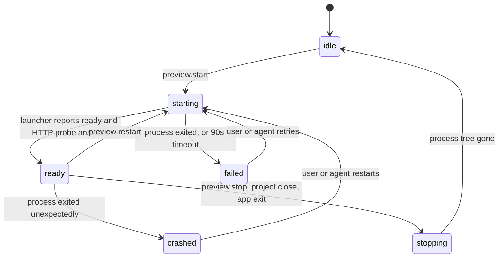

# Live Preview and Visual Editing

> Status: Agreed design. Source mapping confirmed by Spike S2 (ADR-0009, `docs/spikes/S2.md`). Preview isolation confirmed on Windows by Spike S3 (ADR-0010, `docs/spikes/S3.md`).

> **Reading this after ADR-0015 (Code-OSS fork):** "Host" is now the Jesutobits VS Code extension (`apps/vscode-extension/src`); "Workbench" is VS Code's window plus Jesutobits webviews (`apps/vscode-extension/webview`); Tauri IPC and capabilities are webview `postMessage` checked against `packages/protocol/src/webview.ts`; the OS credential store is VS Code SecretStorage; the "Node sidecar" is the runtime process on VS Code's Electron. Explorer, editor, terminal, Git, settings and colour themes are VS Code's. Sections are rewritten as their features are built on the fork.

## 1. Goals and non-goals

Goals:

- Show the user's running web app inside Jesutobits, managed end to end (start, readiness, logs, restart, stop).
- Let the user point at an element and either ask the agent about it or change supported properties directly.
- Turn direct changes into **minimal, real source edits** that survive reloads and show up as normal diffs.

Non-goals for the MVP:

- Visual editing of arbitrary websites or frameworks other than React + Vite.
- Drag-and-drop layout building, adding new elements visually, or editing component props at usage sites.
- Editing styles that live in CSS files, CSS Modules or CSS-in-JS (these route to the agent).

## 2. Three levels, kept distinct everywhere

| Level | What happens | Touches files? | UI marker | Architecture |
|---|---|---|---|---|
| **1. Inspect** | Select an element, see its source location, component, classes and computed styles | No | Blue outline, selection card | Bridge reports; runtime analyses source read-only |
| **2. Draft** (preview-only) | Change a property and see it immediately in the preview | No | Dashed amber outline, "Draft, not saved to code" badge, draft counter in toolbar | Bridge applies inline overrides to matching DOM nodes |
| **3. Apply** (persistent) | Write the change into the JSX source | Yes, through WorkspaceService with a checkpoint | Diff toast with Undo; draft badge disappears after HMR | Runtime `SourceTransformer` splices the file; Vite HMR updates the preview |

Drafts are lost on reload and that is stated in the UI. A navigation or full reload with pending drafts shows "2 draft changes were discarded".

## 3. Preview strategies and the supported subset

`PreviewManager` picks an adapter per project:

| Adapter | When chosen | Visual editing |
|---|---|---|
| `vite-react` (instrumented) | `package.json` has `vite` ≥ 7 (8 preferred, RN-22), `react` ≥ 18, `react-dom`, and `@vitejs/plugin-react` or `@vitejs/plugin-react-swc`; and does **not** use a meta-framework on top (Next.js, Remix, React Router framework mode, Astro, TanStack Start) | **Full** if styling is Tailwind (v3 or v4) or inline styles; **Inspect-only** otherwise |
| `generic` | Any project with a `dev` or `start` script | None. Preview, logs and agent checks work |
| `static` | No dev or start script, and an `index.html` in the root, `public/`, `src/`, `www/`, `site/`, `dist/` or `build/` (plain HTML/CSS/JS sites, canvas games) | None. Jesutobits' own static server (`services/src/preview/static-server.ts`) serves it on loopback with live reload |
| `command` | A start command the user typed in the preview panel ("Start it another way") or the agent passed to `start_preview` (shown on its approval card), saved in `projects.preview_settings_json`; it wins over detection | None. Python, Go, Rust, a backend: shown as a page once it prints an address; a program that prints none within 12 s (a CLI, a game window) is shown as its output (state `running`) |
| None | None of the above | The preview panel asks for the start command; the agent can pass one |

Styling detection for `vite-react`:

- Tailwind v4: `tailwindcss` ≥ 4 plus `@tailwindcss/vite` or a CSS file containing `@import "tailwindcss"`.
- Tailwind v3: `tailwindcss` 3.x plus `tailwind.config.*`.
- Otherwise: inline styles only (still "Full" for the properties in section 7, applied as `style` props).
- If CSS Modules, styled-components or Emotion are detected, the project is labelled "Inspect-only (styles are defined in CSS files or CSS-in-JS)" and every style property routes to the agent.

The detection result is shown in the project header and the preview panel (FR-120).

The static server reads every file through `WorkspaceService` (so nothing outside the project), never serves secret-pattern files (SECURITY.md 6.2) or anything under a dot-folder such as `.git`, answers only GET and HEAD, and adds a small script to HTML pages that reloads them on the runtime's `fs.changed` events. It was chosen over the Live Server extension or the `live-server` package: Jesutobits must start and stop it for the agent, keep it in the preview panel, and keep secret files out.

## 4. Preview Manager

### 4.1 Lifecycle



There is **no automatic restart loop**. A crashed dev server usually has a configuration error that a restart will not fix. The panel shows the last error lines and a Restart button; the agent can read logs and restart through tools.

### 4.2 Port allocation

1. Preferred port: the project's configured dev port if discoverable (Vite `server.port`), else 5173.
2. Check availability by binding a socket on `127.0.0.1:<port>` and closing it. Also check Jesutobits' own port registry (ports held by other Jesutobits preview sessions).
3. If taken, ask the OS for a free port (bind to port 0).
4. Instrumented mode passes the port with `strictPort: true` through the launcher. Generic mode sets `PORT` and, for known CLIs (`vite`, `next dev`, `react-scripts start`), adds the port flag.
5. If the server still reports "address in use", pick a new port and retry up to 3 times. The panel says "Port 5173 was busy, using 5179".
6. The host is always `127.0.0.1` (ADR-0010).

### 4.3 Readiness

- **Instrumented:** the launcher prints a machine-readable line after `server.listen()`: `@@jesutobits {"event":"ready","url":"http://127.0.0.1:5179/"}`. Then the runtime probes `GET /` until any HTTP response arrives (even 404 means the server is up).
- **Generic and command:** the runtime parses output for a loopback URL (`localhost`, `127.0.0.1`, `0.0.0.0`, `[::1]`) or a "listening/running/server … port N" line, then probes. Without either within 12 s the preview becomes `running` and shows the output, still switching to the page if an address appears later.
- **Static:** ready as soon as the server listens.
- Probe interval 300 ms, timeout 90 s (first runs can be slow while dependencies are optimised). The panel shows elapsed time while starting.

### 4.4 Logs and errors

- Each preview session keeps the last 200 lines. Dev servers run with `NO_COLOR=1`, and any ANSI escape sequences left are stripped from each line before the address is looked for and before it is kept, so the UI and the agent both get plain text (a coloured address such as Vite 5's `localhost:` + bold port would otherwise go unrecognised).
- Known error patterns are highlighted and counted: Vite internal server errors, failed import resolution, TypeScript errors from plugins, port errors.
- The bridge forwards page-side errors (`window.onerror`, `unhandledrejection`, a count of `console.error` calls with the first 300 characters) to the preview console tab. These are **untrusted** and displayed as text.

### 4.5 Refresh behaviour

- File changes reach the page through the dev server's HMR. Jesutobits does not reload the iframe on its own except when the user clicks Reload or the dev server requests a full reload.
- Reload preserves the current path. The path field lets the user navigate within the app (same origin only).
- Viewport presets resize the iframe (Mobile 390×844, Tablet 820×1180, Desktop 1280×800, Fit, Custom).

### 4.6 Multiple projects and sessions

- One preview session per project in the MVP (`prv_` IDs already allow more).
- Switching projects stops the previous project's dev server unless the user pinned it (FR-008).
- The port registry prevents two Jesutobits sessions from racing for the same port.

### 4.7 Shutdown

- Stop sends a graceful termination, then kills the process tree after 5 s (ADR-0011).
- Project close and app exit stop all sessions. Crash leftovers are reaped on next start.

### 4.8 The launcher (instrumented mode)

- `preview-launcher.mjs` ships with Jesutobits and runs with the **user's Node** (the project's toolchain, ADR-0011), started by `ProcessSupervisor` with cwd at the project root.
- It resolves `vite` from the project (`createRequire(<root>/package.json)`), checks the version, imports the Jesutobits plugin bundle by absolute file URL, and calls `createServer({ root, server: { host: "127.0.0.1", port, strictPort: true }, plugins: [jesutobitsVisualEdit(options)] })` (RN-23).
- Options passed: project root, nonce, the Workbench origin to accept messages from, and exclusion globs.
- Spike S2 confirmed that the inline plugin runs alongside the project's own plugins (RN-24), appended after them. The plugin's `transform` therefore uses hook-level `order: "pre"` so it sees JSX before any default-order transform. The wrapper-config fallback is not needed.
- The plugin bundle is self-contained (its parser and `magic-string` are bundled) because it runs in the user's toolchain and must not require installing anything into the project.

## 5. Selection

### 5.1 The bridge

`@jesutobits/visual-bridge` is a small script (target under 30 KB minified) injected by the Vite plugin through `transformIndexHtml`. It:

- Draws hover and selection overlays **inside the iframe** in a closed shadow root with `pointer-events: none`, so overlays follow scrolling and zoom without coordinate syncing.
- In Inspect mode, captures `pointermove`, `pointerdown` and `click` at the window capture phase and stops them, so the app does not react.
- Finds the nearest ancestor with `data-jesutobits-loc` for the hovered node. Nodes from library components (no attribute) resolve to their nearest instrumented ancestor, and the card says "Selected the closest element from your code".
- Reports selections, layout changes (`ResizeObserver`, scroll), page errors and HMR updates (`vite:afterUpdate`) to the Workbench.
- Applies and clears draft styles.

### 5.2 Modes

- **Interact** (default): the app behaves normally. No overlays.
- **Inspect**: toggled from the preview toolbar or `Ctrl+Shift+C` (macOS `Cmd+Shift+C`). The iframe gets a coloured border, a banner reads "Inspecting: clicks select elements. Esc to stop", the cursor changes.
- Keyboard in Inspect mode: `Esc` exits, `ArrowUp` parent, `ArrowDown` first child, `ArrowLeft`/`ArrowRight` previous/next sibling, `Enter` opens the source.

### 5.3 Selection payload (bridge → Workbench)

```ts
type BridgeSelection = {
  type: "bridge.selection";
  nonce: string;
  selectionId: string;
  loc: string;                        // "src/components/Hero.tsx:24:7"
  componentChain: string[];           // from ancestor data-jesutobits-comp, nearest first
  tag: string;
  idAttr?: string;
  classList: string[];
  textSnippet: string;                // first 200 chars of textContent
  rect: { x: number; y: number; width: number; height: number };
  computed: Record<"display"|"width"|"height"|"padding"|"margin"|"color"|"backgroundColor"|"fontSize"|"fontWeight"|"textAlign"|"borderRadius"|"borderWidth"|"borderColor"|"borderStyle"|"gap"|"flexDirection"|"justifyContent"|"alignItems", string>;
  instanceCount: number;              // nodes sharing this loc
  instanceIndex: number;
  route: string;                      // location.pathname
};
```

The Workbench validates the payload with Zod and then calls `visual.inspect({ loc })` on the runtime for the source-side analysis.

## 6. Source mapping

### 6.1 Instrumentation rules (`@jesutobits/vite-plugin`)

- `apply: "serve"`, `enforce: "pre"`. Transforms `.jsx` and `.tsx` modules whose resolved path is inside the project root and not in `node_modules` or an excluded glob.
- For each JSX opening element whose name is lowercase (intrinsic) or contains a hyphen (custom element), insert `data-jesutobits-loc="<relPath>:<line>:<column>"` immediately after the tag name. Line and column are 1-based and point at the `<`. Paths use forward slashes.
- Skip elements that already have `data-jesutobits-loc`. Never touch fragments, components (capitalised names) or member expressions (`motion.div`, `Ctx.Provider`) in the MVP.
- For each component function (capitalised function declaration, or capitalised variable bound to an arrow or function expression), add `data-jesutobits-comp="<Name>"` to the intrinsic element(s) at the top level of its returned JSX.
- Edits use `magic-string`, so the original code is untouched apart from inserted attributes, and a high-resolution source map is returned.
- Parsing results are cached by content hash. Budget: under 5 ms per typical component file.

Example, source:

```tsx
export function Hero() {
  return (
    <section className="py-24">
      <h1 className="text-4xl font-bold">Track habits</h1>
      <Button onClick={start}>Get started</Button>
    </section>
  );
}
```

Transformed for the dev server only:

```tsx
export function Hero() {
  return (
    <section data-jesutobits-loc="src/components/Hero.tsx:3:5" data-jesutobits-comp="Hero" className="py-24">
      <h1 data-jesutobits-loc="src/components/Hero.tsx:4:7" className="text-4xl font-bold">Track habits</h1>
      <Button onClick={start}>Get started</Button>
    </section>
  );
}
```

`<Button>` is a component, so it is not instrumented here. Its own intrinsic root (inside `Button.tsx`) carries a loc pointing to `Button.tsx`. Clicking the rendered button selects the element **inside `Button.tsx`**, and the card says "Defined in Button.tsx, used in Hero". Editing it changes every button. The card offers "Ask agent to change only this usage" (FR-121 is the later direct-edit version).

### 6.2 Why not the alternatives

Summarised from ADR-0009: React fiber metadata changed in React 19 (RN-18) and relies on internals; source maps cannot connect DOM nodes to JSX by themselves; writing permanent IDs into user files pollutes their code. Build-time attributes are the approach other tools converged on (RN-20, RN-21).

### 6.3 Keeping selection stable

- After an **Apply**, the runtime knows exactly how offsets shifted and returns the element's new `loc`. The bridge re-selects it after the next `vite:afterUpdate`.
- After an **external edit** (agent or user typing), the Workbench tries the same file, same tag and nearest line. If that fails, the selection clears with "The selected element changed in code".

## 7. Properties inspector

### 7.1 Supported properties in v1

| Group | Property | Tailwind projects | Inline-style projects | Validation |
|---|---|---|---|---|
| Content | Text | Replaces a single static JSX text child | Same | Max 500 chars; `{`, `}`, `<`, `>` escaped for JSX; only if the element's children are one static text node |
| Size | Width, Height | `w-*`, `h-*`, arbitrary `w-[320px]` | `width`, `height` | `auto`, px, %, rem, em, vw, vh; non-negative |
| Spacing | Padding (all, x, y, each side) | `p-*`, `px-*`, `pt-*` ... | `padding*` | Non-negative length |
| Spacing | Margin (all, x, y, each side) | `m-*`, `-m-*` ... | `margin*` | Length, negative allowed, `auto` |
| Colour | Background colour | Palette class if exact match with the default palette, else `bg-[#hex]` | `backgroundColor` | hex, rgb(a), hsl(a), oklch; parsed and normalised |
| Colour | Text colour | `text-*` colour | `color` | Same |
| Typography | Font size | `text-xs` ... `text-9xl` or `text-[15px]` | `fontSize` | Positive length |
| Typography | Font weight | `font-thin` ... `font-black` | `fontWeight` | 100 to 900 in steps of 100 |
| Typography | Text align | `text-left/center/right/justify` | `textAlign` | Enum |
| Border | Radius | `rounded-*` or `rounded-[px]` | `borderRadius` | Non-negative length |
| Border | Width, Colour, Style | `border`, `border-2`, `border-*` colour, `border-dashed` | `border*` | Length, colour, enum |
| Layout | Display | `block`, `inline-block`, `flex`, `grid`, `hidden` | `display` | Enum; `hidden`/`none` asks for confirmation |
| Layout | Flex direction, Justify, Align items, Gap | `flex-row`, `justify-*`, `items-*`, `gap-*` | matching properties | Enums, non-negative gap; shown only when display is flex or grid |
| Image | `src`, `alt` on `` | Attribute edit | Same | `src` must be a relative project path, a `/public` path or an `https://` URL; `javascript:` and non-image `data:` rejected |

**Not supported in v1** (shown under "Other properties: ask the agent"): position and offsets, z-index, transforms, transitions and animations, shadows, opacity, grid templates, CSS variables, fonts, responsive / hover / focus / dark variants (shown read-only with the variant prefix).

### 7.2 Editability analysis (runtime `visual.inspect`)

The runtime parses the file and classifies the element's attributes:

| Attribute state | Example | Result |
|---|---|---|
| `className` absent | `<h1>` | Editable (attribute will be added) |
| `className` string literal | `className="p-4 text-lg"` | Editable |
| `className` static template | ``className={`p-4 text-lg`}`` | Editable |
| `className` dynamic | `className={cn("p-4", active && "bg-blue-500")}` | Read-only: "Classes are computed by cn(). Ask the agent." |
| `style` absent | | Editable (attribute will be added in inline mode) |
| `style` object literal, static value for the property | `style={{ padding: 8 }}` | Editable for that property |
| `style` dynamic | `style={styles.card}` | Read-only |
| Spread props after `className` | `<div className="x" {...rest}>` | Read-only warning: "A spread may override these classes" (edit allowed with confirmation) |
| Children are one static text | `<h1>Track habits</h1>` | Text editable |
| Children include expressions | `<h1>Hi {name}</h1>` | Text read-only |

Precedence: if a property is set statically in `style`, edits go to `style` (it wins in CSS). Otherwise Tailwind projects edit classes. If the computed value is not explained by the element's classes or inline style (it comes from a stylesheet or an ancestor), the inspector shows "Value comes from CSS elsewhere" and offers the agent.

### 7.3 Value entry

- Numeric fields with unit menus, steppers (Shift for ×10), and scale chips for Tailwind (`0, 1, 2, 3, 4, 6, 8, 12, 16`).
- Colour picker with the Tailwind default palette, the project's recently used colours and a free input.
- Every change is validated with the property's Zod schema from `packages/protocol` before it is drafted.
- Invalid input shows an inline message and does not draft.

## 8. Persistent edits

### 8.1 Pipeline

1. Workbench → runtime: `visual.applyEdit({ previewId, loc, expectedFileHash, changes: VisualChange[] })`. This is a **user action**, so it does not go through the agent's permission broker, but it does go through the path guard, Restricted-mode check and WorkspaceService like every write.
2. The runtime reads the file, compares its hash with `expectedFileHash` (mismatch → `visual.stale`, the inspector refreshes).
3. Re-parse, find the JSX opening element at `loc`, re-run editability for each change.
4. Compute the new attribute value (8.2, 8.3) and splice it with `magic-string`. No formatter runs; only the attribute's text range changes.
5. Write atomically, record a checkpoint transaction `vedit_...`, emit `fs.changed`.
6. Return `{ diff, newHash, newLoc }`. The Workbench shows a toast "Updated Hero.tsx (1 line)" with View diff and Undo.
7. The dev server sends HMR; the bridge clears drafts for that `loc` after `vite:afterUpdate`, or after 3 s as a fallback, and re-selects `newLoc`.

```ts
type VisualChange =
  | { kind: "style"; property: SupportedProperty; value: string | null }   // null = reset
  | { kind: "text"; value: string }
  | { kind: "attribute"; name: "src" | "alt"; value: string };
```

`value: null` resets the property: removes the matching Tailwind class or the inline key.

### 8.2 Tailwind class edits

- Map the requested value to a utility: spacing uses the default 0.25rem scale (v4 accepts any multiple; v3 only its fixed keys) else an arbitrary value; colours use the default palette when the value matches exactly, else an arbitrary value. Reading a project's custom theme tokens is **later**.
- Merge with existing classes using `tailwind-merge` semantics so conflicting utilities of the same group in the **base variant** are replaced (`px-2` and new `p-4`), while variant-prefixed classes (`md:p-8`, `hover:bg-x`) are untouched.
- Preserve class order otherwise; append new classes at the end.

### 8.3 Inline style edits

- Add or update the key in a static object literal, using camelCase and numbers for px values where idiomatic (`padding: 16`), strings otherwise.
- If `style` is absent, insert `style={{ ... }}` after the `className` attribute or after the tag name.

### 8.4 Undo and revert

- Each preview session keeps an undo stack of applied edits `{ file, beforeHash, afterHash, preImageBlob }`.
- Undo is enabled while the file's current hash equals `afterHash`. Otherwise it is disabled with "Hero.tsx changed since this edit" and offers "Ask agent to revert this change".
- Visual edits are also listed in the session's checkpoint history, so "Revert" works like agent edits (ADR-0012).

### 8.5 Instances and confirmations

- If `instanceCount > 1`, the Apply button reads "Apply to all 6 instances" and the first time shows a short explanation.
- If the element is defined in a different file from the selected component's usage (section 6.1), Apply shows "This changes Button.tsx, used in 4 places".

## 9. Shell to preview protocol and security boundaries

All messages are `postMessage` objects with `{ jesutobits: 1, type, nonce, ...payload }`. Schemas live in `packages/protocol/src/bridge.ts`; the nonce is 128 random bits as 32 lowercase hex characters (`BridgeNonceSchema`). The Workbench side is `apps/desktop/src/features/preview/frame-channel.ts`.

| Direction | Types |
|---|---|
| Bridge → Workbench | `bridge.hello { version, url }`, `bridge.hover { loc, rect }`, `bridge.selection`, `bridge.layout { rects }`, `bridge.page_error { message, source? }`, `bridge.hmr_after_update { files }`, `bridge.route { path }` |
| Workbench → Bridge | `inspect.set { enabled }`, `select.loc { loc, index? }`, `select.navigate { direction }`, `draft.apply { loc, styles }`, `draft.clear { loc? }`, `highlight.loc { loc }` |

Rules (ADR-0010):

- The Workbench accepts messages only from the exact preview origin (`http://127.0.0.1:<port>`) and with the session nonce. The bridge accepts messages only from the configured Workbench origin.
- Every message is validated with Zod; unknown types are dropped and counted.
- Hover messages are throttled to one per animation frame (NFR-022).
- Nothing in the bridge protocol can trigger file writes, commands, approvals or secret access. File writes require a Workbench user action (Apply) that calls the runtime directly.
- Strings from the bridge are rendered as text, never as HTML.
- Draft styles accept only the validated property set (section 7.1); arbitrary CSS text is rejected.

## 10. Future adapters

```ts
interface PreviewAdapter {
  id: string;                                           // "vite-react", "generic", "next", "expo-web"
  detect(project: ProjectInfo): Promise<DetectResult | null>;
  start(opts: PreviewStartOptions, signal: AbortSignal): Promise<RunningPreview>;
  surface: "iframe" | "external-device" | "simulator-stream";
  capabilities: { instrumentation: boolean; visualEditing: "full" | "inspect-only" | "none"; hmr: boolean };
  sourceTransformer?: SourceTransformer;                // writes for this framework
}
```

- **Next.js:** instrumentation as a loader for the Next dev server (webpack or Turbopack), still adding `data-jesutobits-loc` at the JSX level, which works for server and client components. Needs its own spike.
- **Expo / React Native:** `expo-web` can reuse the DOM approach through `react-native-web` with RN-specific style editing (`StyleSheet` objects). Native device previews use a different surface (`external-device`): QR code for Expo Go plus logs; native element inspection is a separate research item.
- **Usage-site prop editing:** instrument component elements with a separate attribute in a later version, accepting the risk of props reaching non-DOM targets.

## 11. Risks and spikes

| Risk | Impact | Mitigation | Owner |
|---|---|---|---|
| Inline Vite plugin does not merge with project plugins (RN-24) | Instrumented mode fails | Wrapper-config fallback | Spike S2 |
| `http://127.0.0.1` iframe blocked or degraded in an OS webview | No embedded preview on that OS | Proxy via custom protocol; external browser fallback | Spike S3 |
| Projects pass `data-*` props into non-DOM renderers | Warnings or errors in the user's app | Only intrinsic elements instrumented; exclusion globs | Phase 5 |
| HMR timing makes drafts flicker or re-selection fail | Confusing UX | Clear drafts on `afterUpdate` per file; fallback timer; tests with fixture projects | Phase 5 |
| Tailwind custom themes produce surprising classes | Unwanted arbitrary values | Show the exact class diff before applying; theme-aware mapping later | Phase 5 |
| Large pages make hover slow | Laggy inspect mode | Throttle, cache ancestor lookups, cap overlays | Phase 5 |
